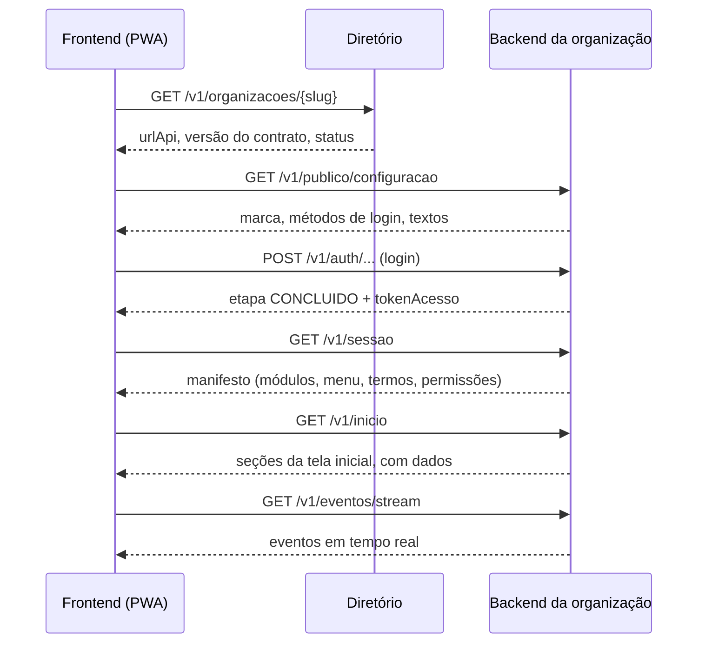

# Prompt do Backend — Contrato da API e Backend de Referência

{{PRODUTO}} · MVP de acompanhamento entre consultas · versão 1.0 · 04/11/2026

## 0. Como usar este prompt

Este documento é o prompt para um agente de engenharia (Claude Code ou equivalente). Esta seção é para você, humano. Da seção 1 em diante, o texto fala com o agente.

- **Onde salvar:** `docs/PROMPT_BACKEND.md`, na raiz do repositório. Se quiser manter o Prompt Mestre original como referência, salve-o em `docs/PROMPT_MESTRE.md`.
- **Ordem de uso:**
  1. **Agora:** peça só a fase **F0** (seção 15). Ela entrega o contrato, um servidor de mentira (mock) com dados de exemplo e a suíte de conformidade. Ainda não existe backend real.
  2. **Depois:** peça o prompt do frontend. O frontend é construído em cima do mock e parece funcionar de verdade.
  3. **Por último:** fases F1 a F3, o backend real. Quando ele passar na suíte de conformidade, o frontend troca do mock para o backend real mudando só o endereço do diretório.
- **Placeholders:** `{{PRODUTO}}` (nome do produto), `{{DOMINIO}}` (domínio principal) e `{{REGIAO_CLOUD}}` (região de hospedagem).
- **Prompt Mestre:** continua valendo como referência para módulos futuros, segurança (seção 5 dele) e legislação (seção 32 dele). Onde os dois divergirem, este documento vale para o MVP.
- **[DECISÃO]** marca escolhas que precisam de confirmação humana antes da implementação. A lista completa está na seção 19.

## 1. Seu papel e o objetivo

Você é o engenheiro responsável pelo **contrato da API** e pelo **backend de referência** do {{PRODUTO}}, uma plataforma para profissionais de saúde acompanharem pacientes entre as consultas.

**A ideia central:** existe **um único frontend**, um PWA instalável e responsivo, usado pela equipe e pelos pacientes. Cada clínica (organização) pode ser atendida por um backend diferente. O frontend não sabe nada da organização de antemão: **ao abrir e ao fazer login, ele consulta o backend e se adapta ao que recebe** (marca, módulos, menu, vocabulário, formulários e permissões).

O que torna isso possível é o **contrato**, o padrão que todo backend segue. Seu trabalho, nesta ordem:
1. escrever o contrato com precisão;
2. provar que ele funciona com um mock;
3. criar uma suíte que verifica se qualquer backend segue o padrão;
4. construir o backend de referência que passa nessa suíte.

### 1.1 Escopo do MVP

O primeiro produto substitui os grupos de WhatsApp que profissionais criam para acompanhar pacientes, começando pelo pós-operatório:
- a equipe cadastra o paciente e o convida para o app (link ou QR code mostrado na consulta);
- inicia um **acompanhamento** a partir de um **protocolo** (por exemplo, "Septoplastia — 7 dias");
- todo dia o paciente recebe um **check-in** (dor, sono, sangramento, foto) e responde pelo app;
- respostas fora do esperado geram **alertas informativos** para a equipe;
- paciente, profissional e secretária conversam num **chat por paciente**, e o histórico fica guardado.

Notificações só por **Web Push e e-mail**: sem WhatsApp e sem SMS. Agenda, pagamentos, carteirinha digital e documentos entram depois (seção 10), e o contrato precisa recebê-los sem quebrar nada.

O vocabulário é configurável. O mesmo produto serve ao cirurgião ("pós-operatório", "cirurgia"), ao fisioterapeuta ("acompanhamento", "sessão") e ao veterinário ("tutor", "pet").

### 1.2 Princípios

1. **Contrato primeiro.** Nenhum endpoint existe fora de `contrato/openapi.yaml`. Se o comportamento muda, o contrato muda antes.
2. **O backend decide, o frontend desenha.** Regras, permissões, cálculos e textos configuráveis vêm do backend. O frontend só renderiza, a partir de um catálogo fixo de telas e componentes.
3. **Customização é configuração, não fork.** O que varia entre clientes vira dado. O que não dá para configurar vira um módulo novo do catálogo, disponível para todos e ligado por configuração.
4. **Compatível para frente.** O frontend ignora, sem erro, o que não conhece: campos, módulos, telas, seções, ícones, eventos e valores de enum. Dentro da mesma versão maior, o contrato só cresce.
5. **O mínimo que funciona.** Nada de Kubernetes, RabbitMQ ou microsserviços no MVP.

## 2. Como a adaptação funciona

### 2.1 As três camadas

| Camada | Quando | Endpoint | Para quê |
|---|---|---|---|
| Diretório | ao abrir o app | `GET https://diretorio.{{DOMINIO}}/v1/organizacoes/{slug}` | descobrir qual backend atende a organização |
| Configuração pública | antes do login | `GET {urlApi}/v1/publico/configuracao` | marca, métodos de login e textos da tela de entrada |
| Manifesto da sessão | depois do login | `GET {urlApi}/v1/sessao` | o que o app mostra para aquele usuário, naquele perfil |

### 2.2 Sequência ao abrir o app



### 2.3 O que o backend controla

| O backend decide | Exemplo | Onde |
|---|---|---|
| Marca | nome, logo, cor, ícone do app instalado | configuração pública: `tema`, `pwa` |
| Login | métodos disponíveis, MFA obrigatório | configuração pública: `autenticacao` |
| Módulos | chat ligado, agenda desligada | manifesto: `modulos` |
| Menu | itens, ordem, ícones, contadores | manifesto: `navegacao` |
| Tela inicial | quais seções, em que ordem, com que dados | `GET /v1/inicio` |
| Vocabulário | paciente, cliente ou pet, com gênero gramatical | manifesto: `termos` |
| Formulários | perguntas do check-in, campos extras do cadastro | formulários e protocolos (seção 9) |
| Permissões | o que o usuário pode fazer, item a item | manifesto: `permissoes`; recursos: `acoesPermitidas` |
| Recursos técnicos | tempo real por SSE ou polling; push | manifesto: `capacidades` |
| Regras dos módulos | horário do chat, aviso de urgência | manifesto: `modulos[].config` |

**O backend não decide:** telas ou componentes que o frontend não tem, layout, cores semânticas (sucesso, atenção, erro) e etapas de login fora das previstas na seção 5.2. O que vier fora do catálogo é ignorado pelo frontend.

### 2.4 Como o frontend descobre a organização

- Pelo endereço: `{slug}.{{DOMINIO}}`, ou pelo domínio próprio da clínica (`app.clinicax.com.br`), resolvido no diretório.
- Pelo link ou QR code de convite.
- Em desenvolvimento: parâmetro `?org={slug}`.

## 3. Topologia e implantação

### 3.1 Modelos de backend aceitos

| Modelo | Quando usar |
|---|---|
| **A. Backend de referência compartilhado** (várias organizações no mesmo banco, isoladas por RLS) | padrão e recomendado |
| **B. Instância dedicada do backend de referência** (mesmo código, banco separado) | cliente que exige isolamento físico |
| **C. Backend próprio do cliente** | só se passar na suíte de conformidade da versão do contrato |

Nos três casos o frontend é o mesmo, e o diretório aponta cada organização para o seu `urlApi`.

**Não crie variações do código do backend por cliente.** Cada correção, atualização de segurança ou mudança regulatória teria de ser feita N vezes. Diferença entre clientes é configuração (seção 1.2).

### 3.2 Regra do mesmo site (obrigatória)

O frontend de uma organização e a API dela ficam no **mesmo site**, isto é, no mesmo domínio registrável. Exemplos: `modelo-otorrino.{{DOMINIO}}` com `api.modelo-otorrino.{{DOMINIO}}`, ou `app.clinicax.com.br` com `api.clinicax.com.br`.

**Por quê:** o token de renovação fica num cookie HttpOnly, e o Safari bloqueia cookies de outro site. Com app e API em domínios diferentes, o login quebraria no iPhone, que é o aparelho de boa parte dos pacientes.

Consequências:
- o mesmo build estático do frontend é servido em vários domínios, um por organização;
- cada organização vira um app instalável próprio, com nome e ícone da clínica;
- quem trabalha em duas clínicas instala o app duas vezes (aceitável no MVP);
- `urlApi` pode ter caminho (`https://api.{{DOMINIO}}/o/modelo-otorrino`); o mock usa esse formato;
- CORS: a API aceita apenas as origens do frontend da própria organização.

### 3.3 Diretório

Serviço nosso, sem dado de paciente e sem lista de usuários. No começo pode ser um conjunto de arquivos JSON estáticos na CDN.

| Método | Caminho | Resposta |
|---|---|---|
| GET | `/v1/organizacoes/{slug}` | organização resolvida |
| GET | `/v1/organizacoes?dominio={host}` | resolução por domínio próprio |

```json
{
  "slug": "modelo-otorrino",
  "nome": "Clínica Modelo Otorrino",
  "urlApi": "https://api.modelo-otorrino.{{DOMINIO}}",
  "contratoVersao": "1.0.0",
  "status": "ATIVA"
}
```

`status` pode ser `ATIVA`, `MANUTENCAO` (o frontend mostra a tela de manutenção) ou `SUSPENSA`. Organização desconhecida devolve 404.

## 4. Regras gerais do contrato

### 4.1 Fonte da verdade

- `contrato/openapi.yaml` (OpenAPI 3.1), `contrato/schemas/*.schema.json` (JSON Schema 2020-12) e `contrato/exemplos/`.
- **Spec-first:** o YAML é escrito e revisado como documento. Tipos TypeScript e um cliente tipado são gerados a partir dele para o mock, a suíte de conformidade, o frontend e o backend de referência. Não gere o contrato a partir do código (o Prompt Mestre usava Zod), porque backends de clientes podem não ser em TypeScript. Registre em ADR.
- Lint do contrato com Spectral, com regras próprias para os nomes da seção 4.3.
- Documentação HTML gerada do YAML, para quem for implementar um backend.

### 4.2 Versão e compatibilidade

- Caminhos em `/v1`. A versão semântica do contrato fica em `info.version` e em `contrato.versao`, na configuração pública e no manifesto.
- Da F0 até o fim da F2, o contrato é `1.0.0-rc.N` e ainda pode mudar. Depois disso, `1.0.0` é congelado.
- Dentro de `1.x`, só mudanças aditivas: endpoint novo, campo opcional novo na resposta, valor novo de enum, módulo, tela, seção, ícone ou evento novos.
- Quebra (remover ou renomear campo, mudar tipo ou significado, tornar obrigatório um campo de requisição) exige `2.0.0`, com as duas versões convivendo até a migração.
- Cada módulo tem versão própria em `modulos[].versao`.
- Toda mudança entra em `contrato/CHANGELOG.md`.

### 4.3 Nomes

- JSON em camelCase, em português, sem acento nem cedilha: `nomeExibicao`, `corMarca`. Os campos padrão do RFC 9457 (`type`, `title`, `status`, `detail`, `instance`) ficam em inglês.
- Enums em maiúsculas com sublinhado: `PROFISSIONAL`, `CHECKIN_EXPIRADO`.
- Campos de data e hora terminam em `Em` e usam o masculino genérico, qualquer que seja o gênero da entidade: `criadoEm`, `enviadoEm`, `lidoEm`.
- Caminhos no plural, em kebab-case: `/v1/conversas/{conversaId}/mensagens`.
- Tipos de evento em minúsculas, no formato `modulo.entidade.fato`: `chat.mensagem.criada`.

### 4.4 Tipos de dado

- **IDs:** strings opacas, que o frontend nunca interpreta. No backend de referência, UUIDv7 com prefixo legível (`pac_…`, `cnv_…`).
- **Data e hora:** ISO 8601 em UTC (`2026-11-04T12:00:00Z`). **Data sem hora:** `AAAA-MM-DD`. **Hora local** de protocolo: `HH:MM` no fuso da organização (`organizacao.fuso`).
- **Dinheiro** (v2): inteiro em centavos mais `moeda` (`BRL`).
- **Telefone** em E.164; **e-mail** em minúsculas.

### 4.5 Erros

Todo erro usa `application/problem+json` (RFC 9457) com um `codigo` estável, que o frontend usa para escolher a mensagem.

```json
{
  "type": "https://{{DOMINIO}}/erros/validacao-falhou",
  "title": "Dados inválidos",
  "status": 422,
  "detail": "Alguns campos precisam de correção.",
  "codigo": "VALIDACAO_FALHOU",
  "requestId": "req_01JC5A2B9K",
  "campos": [
    { "campo": "respostas.dor", "codigo": "OBRIGATORIO", "mensagem": "Informe o nível de dor." }
  ]
}
```

Regras:
- recurso de outra organização, ou que o usuário não pode ver, devolve **404**, nunca 403, para não revelar que existe. O 403 (`PERMISSAO_NEGADA`) fica para ação proibida sobre algo que o usuário vê;
- `401` com `SESSAO_EXPIRADA` faz o frontend renovar o token uma vez e repetir a chamada;
- nunca stack trace, SQL ou nome de tabela na resposta.

Códigos da v1: `AUTENTICACAO_INVALIDA`, `CODIGO_INVALIDO`, `CODIGO_EXPIRADO`, `MUITAS_TENTATIVAS`, `SESSAO_EXPIRADA`, `SESSAO_REVOGADA`, `PERMISSAO_NEGADA`, `RECURSO_NAO_ENCONTRADO`, `VALIDACAO_FALHOU`, `CONFLITO_VERSAO`, `LIMITE_EXCEDIDO`, `CONVITE_INVALIDO`, `CONVITE_EXPIRADO`, `MODULO_NAO_CONTRATADO`, `ORGANIZACAO_SUSPENSA`, `CHECKIN_INDISPONIVEL`, `CHECKIN_JA_RESPONDIDO`, `CONVERSA_ARQUIVADA`, `ARQUIVO_MUITO_GRANDE`, `TIPO_ARQUIVO_NAO_PERMITIDO`, `ARQUIVO_REJEITADO`, `CURSOR_EXPIRADO`, `ULTIMO_GESTOR`, `INDISPONIVEL_TEMPORARIAMENTE`.

### 4.6 Listas e busca

- Listas devolvem `{ "itens": [...], "proximoCursor": "..." }`, com `?cursor=&limite=` (padrão 20, máximo 100). `proximoCursor` nulo indica o fim. O cursor é opaco.
- Filtros e ordenação: só os documentados em cada endpoint.
- **Busca por texto livre vai no corpo de um `POST .../busca`, nunca em query string**, porque o texto costuma ser o nome do paciente e URLs acabam em logs.

### 4.7 Idempotência e concorrência

- **(I)** nas tabelas: o POST exige `Idempotency-Key`. Repetir com a mesma chave devolve a mesma resposta, sem duplicar, por 24 h. Isso importa porque o paciente usa celular com rede instável.
- **(E)** nas tabelas: o recurso devolve `ETag`, e a edição envia `If-Match`. Versão desatualizada recebe `412` com `CONFLITO_VERSAO` e o estado atual no corpo.

### 4.8 Ações permitidas

Todo recurso traz `acoesPermitidas`, calculadas pelo backend para aquele usuário naquele item. O frontend mostra ou esconde botões só com base nisso e em `permissoes` (para ações que não dependem de um item). Ele nunca replica regra de negócio como vínculo, horário ou status.

```json
{ "id": "chk_01JC6D", "status": "DISPONIVEL", "acoesPermitidas": ["RESPONDER"] }
```

### 4.9 Cabeçalhos

| Cabeçalho | Uso |
|---|---|
| `Authorization: Bearer <tokenAcesso>` | toda rota autenticada |
| `X-Request-Id` | o backend gera se não vier e sempre devolve; o mesmo id vai para logs e eventos |
| `Idempotency-Key` | POST marcados com (I) |
| `If-Match` / `ETag` | recursos marcados com (E) |
| `X-Cliente: WEB` ou `NATIVO` e `X-Cliente-Versao` | tipo e versão do frontend |
| `RateLimit-*` e `Retry-After` | em respostas 429 |

### 4.10 Privacidade no contrato

- Nada de dado clínico ou nome de paciente em URL, query string, notificação push, payload de evento ou log.
- Arquivos só por URL assinada com validade de até 5 minutos.
- Minimização: o MVP não coleta CPF nem outro documento.

## 5. Autenticação

### 5.1 Métodos

| Método | Quem usa | Como funciona |
|---|---|---|
| `SENHA` | equipe | e-mail e senha, mais MFA por TOTP. MFA obrigatório para a equipe é recomendado já no piloto [DECISÃO] |
| `CODIGO_EMAIL` | paciente ou responsável | código de 6 dígitos por e-mail, válido por 10 minutos, até 5 tentativas |
| Convite | paciente ou membro novo | token de uso único do link ou QR code; cria a conta e faz o vínculo |

A configuração pública diz quais métodos a organização oferece.

### 5.2 Etapas

Toda resposta de login traz `etapa`. O frontend tem uma tela para cada uma, e toda etapa diferente de `CONCLUIDO` devolve um `desafioId` para continuar:

| etapa | O que o frontend faz |
|---|---|
| `CONCLUIDO` | guarda o token em memória e busca `GET /v1/sessao` |
| `MFA` | pede o código TOTP ou um código de recuperação |
| `CONFIGURAR_MFA` | mostra o QR do TOTP e depois os códigos de recuperação |
| `CODIGO_ENVIADO` | pede o código enviado por e-mail |
| `TROCAR_SENHA` | pede uma nova senha (primeiro acesso ou senha vencida) |
| `ACEITAR_TERMOS` | mostra os termos vigentes e envia o aceite |

```json
{
  "etapa": "MFA",
  "desafioId": "dsf_01JC5B7M",
  "metodosMfa": ["TOTP", "CODIGO_RECUPERACAO"]
}
```

```json
{
  "etapa": "CONCLUIDO",
  "tokenAcesso": "eyJhbGciOiJFZERTQSJ9.exemplo",
  "expiraEm": "2026-11-04T12:15:00Z"
}
```

### 5.3 Tokens

- **`tokenAcesso`:** curto (10 a 15 minutos), vem no corpo da resposta, fica só em memória e vai no cabeçalho `Authorization`.
- **`tokenRenovacao`:** rotacionado a cada uso, com detecção de reuso (reuso revoga a sessão inteira). No web, vai num cookie `HttpOnly; Secure; SameSite=Strict`, restrito ao caminho de `/v1/auth` dentro de `urlApi`. No app nativo (futuro, com `X-Cliente: NATIVO`), vem no corpo e fica no cofre seguro do aparelho.
- Validade sugerida da renovação: 14 dias para a equipe e 90 dias para pacientes, que raramente devem precisar entrar de novo [DECISÃO].
- Nunca guarde token em `localStorage`.

### 5.4 Endpoints

| Método | Caminho | Corpo | Resposta |
|---|---|---|---|
| POST | `/v1/auth/entrar` | `email`, `senha` | etapa |
| POST | `/v1/auth/codigo/solicitar` | `email` | sempre 202, sem revelar se o e-mail existe |
| POST | `/v1/auth/codigo/verificar` | `email`, `codigo` | etapa |
| POST | `/v1/auth/convites/{token}/aceitar` | `email`, `termosVersao` | etapa (`CONCLUIDO` ou `CODIGO_ENVIADO`, se o backend quiser confirmar o e-mail) |
| POST | `/v1/auth/mfa/verificar` | `desafioId`, `codigo` | etapa |
| POST | `/v1/auth/mfa/totp/iniciar` | `desafioId` | `uriOtpauth`, `segredo` |
| POST | `/v1/auth/mfa/totp/confirmar` | `desafioId`, `codigo` | etapa e `codigosRecuperacao` |
| POST | `/v1/auth/senha/trocar` | `desafioId`, `novaSenha` | etapa |
| POST | `/v1/auth/termos/aceitar` | `desafioId`, `termosVersao` | etapa |
| POST | `/v1/auth/senha/esqueci` | `email` | sempre 202 |
| POST | `/v1/auth/senha/redefinir` | `token`, `novaSenha` | 204 |
| POST | `/v1/auth/renovar` | nada (cookie) ou `tokenRenovacao` (nativo) | `tokenAcesso`, `expiraEm` |
| POST | `/v1/auth/sair` | `todas` (opcional, encerra todos os aparelhos) | 204 |

Limites por e-mail, por IP e por organização. Excesso devolve 429 com `MUITAS_TENTATIVAS`.

## 6. Configuração pública

| Método | Caminho | Para quê |
|---|---|---|
| GET | `/v1/publico/configuracao` | marca, login e textos (exemplo abaixo) |
| GET | `/v1/publico/convites/{token}` | dados mínimos do convite: tipo, organização, nome parcial e e-mail mascarado |
| GET | `/v1/publico/saude` | status e versão do contrato |

```json
{
  "contrato": { "versao": "1.0.0" },
  "status": "ATIVA",
  "mensagemStatus": null,
  "frontend": { "versaoMinima": "1.0.0" },
  "organizacao": {
    "slug": "modelo-otorrino",
    "nome": "Clínica Modelo Otorrino",
    "fuso": "America/Sao_Paulo",
    "locale": "pt-BR"
  },
  "tema": {
    "corMarca": "#3B5BFD",
    "logoUrl": "https://cdn.exemplo/modelo-otorrino/logo.svg",
    "logoEscuroUrl": "https://cdn.exemplo/modelo-otorrino/logo-escuro.svg",
    "modoPadrao": "SISTEMA"
  },
  "pwa": {
    "nome": "Clínica Modelo Otorrino",
    "nomeCurto": "Modelo",
    "corTema": "#3B5BFD",
    "icones": [
      { "src": "https://cdn.exemplo/modelo-otorrino/icone-192.png", "tamanho": "192x192" },
      { "src": "https://cdn.exemplo/modelo-otorrino/icone-512.png", "tamanho": "512x512", "proposito": "maskable" }
    ]
  },
  "autenticacao": {
    "metodos": [
      { "tipo": "CODIGO_EMAIL", "publico": "PACIENTE" },
      { "tipo": "SENHA", "publico": "EQUIPE", "mfa": "OBRIGATORIO" }
    ],
    "cadastroPaciente": "SOMENTE_CONVITE"
  },
  "textos": {
    "boasVindasTitulo": "Sua recuperação, acompanhada de perto",
    "boasVindasTexto": "Converse com a equipe e responda seu check-in diário."
  },
  "links": {
    "termosDeUso": "https://modelo-otorrino.exemplo/termos",
    "privacidade": "https://modelo-otorrino.exemplo/privacidade",
    "suporte": "mailto:contato@modelo-otorrino.exemplo"
  }
}
```

Regras:
- `frontend.versaoMinima`: se o frontend instalado for mais antigo, ele força a atualização (o PWA pode estar em cache).
- `autenticacao.metodos[].publico` (`EQUIPE` ou `PACIENTE`) permite à tela de login oferecer "Sou paciente" e "Sou da equipe".
- `cadastroPaciente`: `SOMENTE_CONVITE` no MVP; `ABERTO` fica para quando existir agendamento online.
- `tema.corMarca`: o frontend valida o contraste e gera a escala de cores. As cores semânticas não mudam.
- Resposta com `ETag` e `Cache-Control: max-age=300`.

## 7. Manifesto da sessão

`GET /v1/sessao` devolve tudo o que o frontend precisa para montar o app do usuário logado, no perfil ativo. Exemplo: médica no cenário de pós-operatório.

```json
{
  "contrato": { "versao": "1.0.0" },
  "organizacao": {
    "id": "org_01JC4Z7Q",
    "slug": "modelo-otorrino",
    "nome": "Clínica Modelo Otorrino",
    "fuso": "America/Sao_Paulo",
    "locale": "pt-BR",
    "contato": {
      "telefone": "+551130000000",
      "email": "contato@modelo-otorrino.exemplo",
      "endereco": "Av. Exemplo, 100 — São Paulo/SP"
    }
  },
  "usuario": {
    "id": "usr_01JC4Z9A",
    "nome": "Ana Lima",
    "nomeExibicao": "Dra. Ana Lima",
    "email": "ana@modelo-otorrino.exemplo",
    "fotoUrl": null,
    "preferencias": { "tema": "SISTEMA", "densidade": "CONFORTAVEL" }
  },
  "perfilAtivo": "PROFISSIONAL",
  "perfisDisponiveis": [
    { "id": "PROFISSIONAL", "rotulo": "Médica" },
    { "id": "GESTOR", "rotulo": "Gestão da clínica" }
  ],
  "termos": {
    "organizacao": { "singular": "clínica", "plural": "clínicas", "genero": "F" },
    "paciente": { "singular": "paciente", "plural": "pacientes", "genero": "M" },
    "responsavel": { "singular": "responsável", "plural": "responsáveis", "genero": "M" },
    "profissional": { "singular": "médico", "plural": "médicos", "genero": "M" },
    "acompanhamento": { "singular": "pós-operatório", "plural": "pós-operatórios", "genero": "M" },
    "protocolo": { "singular": "protocolo", "plural": "protocolos", "genero": "M" },
    "procedimento": { "singular": "cirurgia", "plural": "cirurgias", "genero": "F" },
    "checkin": { "singular": "check-in", "plural": "check-ins", "genero": "M" },
    "conversa": { "singular": "conversa", "plural": "conversas", "genero": "F" }
  },
  "modulos": [
    {
      "id": "pacientes",
      "versao": "1.0",
      "config": { "formularioCadastroId": "frm_cadastro_basico", "relacoesPermitidas": ["PROPRIO", "DEPENDENTE"] }
    },
    {
      "id": "acompanhamento",
      "versao": "1.0",
      "config": { "publicarCheckinNaConversa": true }
    },
    {
      "id": "chat",
      "versao": "1.0",
      "config": {
        "pacientePodeIniciar": false,
        "anexosPermitidos": true,
        "horarioAtendimento": [
          { "diaSemana": 1, "inicio": "08:00", "fim": "18:00" },
          { "diaSemana": 2, "inicio": "08:00", "fim": "18:00" },
          { "diaSemana": 3, "inicio": "08:00", "fim": "18:00" },
          { "diaSemana": 4, "inicio": "08:00", "fim": "18:00" },
          { "diaSemana": 5, "inicio": "08:00", "fim": "18:00" }
        ],
        "mensagemForaDoHorario": "Recebemos sua mensagem. A equipe responde de segunda a sexta, das 8h às 18h.",
        "avisoUrgencia": "Em caso de sangramento intenso, falta de ar ou febre alta, procure um pronto-socorro ou ligue 192."
      }
    },
    { "id": "equipe", "versao": "1.0", "config": {} }
  ],
  "navegacao": [
    { "id": "inicio", "rotulo": "Início", "icone": "house", "grupo": "PRINCIPAL", "destino": { "tela": "inicio" } },
    { "id": "acompanhamentos", "rotulo": "Pós-operatórios", "icone": "activity", "grupo": "PRINCIPAL", "destino": { "tela": "acompanhamento.lista" }, "contador": "acompanhamento.alertasAbertos" },
    { "id": "conversas", "rotulo": "Conversas", "icone": "message-circle", "grupo": "PRINCIPAL", "destino": { "tela": "chat.lista" }, "contador": "chat.naoLidas" },
    { "id": "pacientes", "rotulo": "Pacientes", "icone": "users", "grupo": "PRINCIPAL", "destino": { "tela": "pacientes.lista" } },
    { "id": "protocolos", "rotulo": "Protocolos", "icone": "clipboard-list", "grupo": "SECUNDARIO", "destino": { "tela": "acompanhamento.protocolos" } }
  ],
  "permissoes": [
    "pacientes.paciente.ler",
    "pacientes.paciente.criar",
    "pacientes.paciente.editar",
    "pacientes.paciente.convidar",
    "acompanhamento.protocolo.ler",
    "acompanhamento.protocolo.gerenciar",
    "acompanhamento.acompanhamento.ler",
    "acompanhamento.acompanhamento.criar",
    "acompanhamento.acompanhamento.encerrar",
    "acompanhamento.checkin.ler",
    "acompanhamento.alerta.ler",
    "acompanhamento.alerta.resolver",
    "chat.conversa.ler",
    "chat.conversa.criar",
    "chat.conversa.gerenciar",
    "chat.mensagem.enviar",
    "equipe.membro.ler"
  ],
  "capacidades": {
    "tempoReal": { "modo": "SSE", "intervaloPollingSegundos": 20 },
    "push": { "modo": "WEB_PUSH", "chavePublicaVapid": "BExemploDeChavePublicaVapidEmBase64Url" },
    "upload": { "tamanhoMaximoBytes": 15728640, "tiposPermitidos": ["image/jpeg", "image/png", "image/webp"] }
  },
  "contadores": {
    "chat.naoLidas": 3,
    "notificacoes.naoLidas": 5,
    "acompanhamento.alertasAbertos": 1,
    "acompanhamento.checkinsPendentes": 0
  }
}
```

### 7.1 Regras do manifesto

- Vale para o **perfil ativo**. Trocar de perfil (`PUT /v1/sessao/perfil-ativo`) gera outro manifesto.
- Vem com `ETag`. O frontend guarda o último manifesto para abrir rápido e revalida com `If-None-Match`.
- Quando algo muda (o gestor liga um módulo, uma permissão é alterada), o backend emite `sessao.manifesto.alterado` e o frontend busca de novo.
- `navegacao[].destino.tela` só aponta para telas de módulos presentes em `modulos`.
- `navegacao[].grupo`: `PRINCIPAL` (barra inferior no celular, até 5 itens) ou `SECUNDARIO` (menu "Mais").
- Os `rotulo` já vêm prontos para exibir. `termos` servem para os textos que o frontend monta ("Novo paciente", "Nenhuma cirurgia"): vêm em minúsculas, e o `genero` (`M` ou `F`) decide entre "novo/nova", "nenhum/nenhuma" e "o/a".
- No perfil `PACIENTE`, o manifesto traz também `pacientesVinculados` (seção 9.1).
- `capacidades.tempoReal.modo`: `SSE` ou `POLLING`. Em `POLLING`, ou se o SSE falhar, o frontend consulta `GET /v1/eventos` a cada `intervaloPollingSegundos`.

### 7.2 Catálogos da v1

Os catálogos ficam em `contrato/schemas/` como listas fechadas. Valor fora delas é ignorado pelo frontend.

**Perfis:** `GESTOR`, `PROFISSIONAL`, `SECRETARIA`, `PACIENTE`. Uma pessoa pode ter mais de um (a médica que é dona do consultório é `GESTOR` e `PROFISSIONAL`).

**Módulos:** `pacientes`, `acompanhamento`, `chat`, `equipe`. O núcleo (conta, notificações, arquivos e eventos) existe sempre e não aparece na lista.

**Telas:**

| Tela | Quem usa | Parâmetros |
|---|---|---|
| `inicio` | todos | – |
| `notificacoes` | todos | – |
| `perfil` | todos | – |
| `pacientes.lista` | equipe | – |
| `pacientes.detalhe` | equipe | `pacienteId` |
| `pacientes.novo` | equipe | – |
| `acompanhamento.lista` | equipe | – |
| `acompanhamento.meus` | paciente | – |
| `acompanhamento.detalhe` | todos | `acompanhamentoId` |
| `acompanhamento.novo` | equipe | `pacienteId` (opcional) |
| `acompanhamento.protocolos` | equipe | – |
| `acompanhamento.protocolo` | equipe | `protocoloId` |
| `acompanhamento.checkin` | todos | `checkinId` |
| `chat.lista` | todos | – |
| `chat.conversa` | todos | `conversaId` |
| `equipe.lista` | gestor | – |
| `organizacao.configuracao` | gestor | – |

**Termos:** `organizacao`, `paciente`, `responsavel`, `profissional`, `acompanhamento`, `protocolo`, `procedimento`, `checkin`, `conversa`. Cada um com `singular`, `plural` e `genero`.

**Contadores:** `chat.naoLidas`, `notificacoes.naoLidas`, `acompanhamento.alertasAbertos`, `acompanhamento.checkinsPendentes`.

**Ícones** (nomes do Lucide): `house`, `users`, `user`, `user-plus`, `activity`, `heart-pulse`, `message-circle`, `bell`, `settings`, `clipboard-list`, `calendar`, `stethoscope`, `paw-print`, `circle-alert`, `file-text`, `camera`, `credit-card`, `circle-help`, `log-out`. Nome desconhecido vira um ícone genérico.

## 8. Núcleo

### 8.1 Conta e tela inicial

| Método | Caminho | Para quê |
|---|---|---|
| GET | `/v1/sessao` | manifesto (seção 7) |
| PUT | `/v1/sessao/perfil-ativo` | troca de perfil: devolve novo `tokenAcesso`, e o frontend busca o manifesto de novo |
| GET | `/v1/contadores` | contadores atuais, com as mesmas chaves do manifesto |
| GET | `/v1/me` | dados da conta e, para paciente, `pacientesVinculados` |
| PATCH | `/v1/me` (E) | `nomeExibicao`, `fotoArquivoId`, `preferencias` |
| POST | `/v1/me/exclusao` | pede a exclusão da conta: remove o acesso e explica o que a clínica precisa guardar por lei |
| GET | `/v1/inicio` | seções da tela inicial, já com dados |

A tela inicial é montada pelo backend a partir de um catálogo de seções. O frontend desenha cada `tipo` que conhece, na ordem recebida.

| Tipo de seção | Para quem | Dados |
|---|---|---|
| `ACOMPANHAMENTO_ATUAL` | paciente | dia atual e total de dias, próximo check-in, orientação do dia |
| `CHECKINS_PENDENTES` | paciente | check-ins disponíveis para responder |
| `ALERTAS_ABERTOS` | equipe | alertas abertos, do mais grave ao menos grave |
| `CHECKINS_DO_DIA` | equipe | quantos foram respondidos, estão pendentes ou expiraram, com a lista |
| `ACOMPANHAMENTOS_ATIVOS` | equipe | lista resumida |
| `CONVERSAS_RECENTES` | todos | lista resumida |
| `ATALHOS` | todos | itens com `rotulo`, `icone` e `destino` |
| `AVISO` | todos | `titulo`, `texto`, `severidade` |
| `CONTATO_ORGANIZACAO` | paciente | telefone, endereço e link do mapa |

```json
{
  "secoes": [
    {
      "id": "acompanhamento-atual",
      "tipo": "ACOMPANHAMENTO_ATUAL",
      "dados": {
        "acompanhamentoId": "acp_01JC6A",
        "titulo": "Septoplastia — 7 dias",
        "diaAtual": 3,
        "totalDias": 7,
        "proximoCheckin": { "id": "chk_01JC6D", "status": "DISPONIVEL", "expiraEm": "2026-11-09T02:00:00Z" },
        "orientacaoDoDia": "Hoje começam as lavagens nasais com soro, 3 vezes ao dia."
      }
    },
    {
      "id": "contato",
      "tipo": "CONTATO_ORGANIZACAO",
      "dados": {
        "telefone": "+551130000000",
        "endereco": "Av. Exemplo, 100 — São Paulo/SP",
        "mapaUrl": "https://maps.exemplo/clinica-modelo-otorrino"
      }
    }
  ]
}
```

### 8.2 Notificações e push

| Método | Caminho | Para quê |
|---|---|---|
| GET | `/v1/notificacoes` | central de notificações (filtro `naoLidas`) |
| POST | `/v1/notificacoes/leitura` | marca como lidas: `ids` ou `todas` |
| GET / PUT | `/v1/notificacoes/preferencias` | canais (push, e-mail) por tipo de notificação |
| POST | `/v1/notificacoes/push/inscricoes` (I) | registra o aparelho: `inscricao` (o objeto `PushSubscription` do navegador, como ele vem) e `dispositivo` (texto livre) |
| DELETE | `/v1/notificacoes/push/inscricoes/{inscricaoId}` | remove o aparelho |

Tipos da v1: `CHAT_MENSAGEM`, `CHECKIN_DISPONIVEL`, `CHECKIN_LEMBRETE`, `ALERTA_CRIADO`, `ACOMPANHAMENTO_INICIADO`, `ACOMPANHAMENTO_CONCLUIDO`, `CONVITE_ACEITO`, `SISTEMA`.

```json
{
  "id": "ntf_01JC6M",
  "tipo": "CHECKIN_DISPONIVEL",
  "titulo": "Check-in disponível",
  "texto": "Seu check-in de hoje já pode ser respondido.",
  "criadoEm": "2026-11-08T12:00:05Z",
  "lidoEm": null,
  "destino": { "tela": "acompanhamento.checkin", "parametros": { "checkinId": "chk_01JC6D" } }
}
```

Payload do push (cifrado pelo padrão Web Push, com no máximo 4 KB):

```json
{
  "notificacaoId": "ntf_01JC6M",
  "titulo": "Clínica Modelo Otorrino",
  "texto": "Seu check-in de hoje está disponível.",
  "tag": "checkin",
  "destino": { "tela": "acompanhamento.checkin", "parametros": { "checkinId": "chk_01JC6D" } }
}
```

Regras:
- **RN-NOT-001** Toda notificação aparece na central. Push e e-mail são cópias discretas dela.
- **RN-NOT-002** Push e e-mail nunca levam conteúdo clínico nem nome de paciente: "Você tem uma nova mensagem da Clínica Modelo Otorrino".
- **RN-NOT-003** Canal: push quando o usuário tem inscrição ativa. Sem push, e-mail para `CHECKIN_DISPONIVEL`, `CHECKIN_LEMBRETE` e `ALERTA_CRIADO`. Para `CHAT_MENSAGEM` sem push, no máximo um e-mail por conversa a cada 6 horas.
- **RN-NOT-004** Inscrição recusada pelo serviço de push (404 ou 410) é removida, e o campo `acessoApp.notificacoes` do paciente é recalculado.
- **RN-NOT-005** No iPhone, o push só funciona com o app adicionado à tela de início (iOS 16.4 ou mais novo). O backend não precisa saber disso: ele só reage a ter ou não inscrição ativa.

### 8.3 Arquivos

O fluxo de envio é sempre o mesmo, e o backend escolhe onde guardar:
1. `POST /v1/arquivos` com `nome`, `tipo`, `tamanhoBytes` e `finalidade` (`CHECKIN`, `CHAT`, `PERFIL`, `ORGANIZACAO`).
2. O frontend envia os bytes para `envio.url`, com o método e os cabeçalhos indicados.
3. `POST /v1/arquivos/{arquivoId}/concluir`.
4. O backend valida e processa. O status vira `DISPONIVEL` ou `REJEITADO`, com aviso pelo evento `arquivo.processado`.

| Método | Caminho | Para quê |
|---|---|---|
| POST | `/v1/arquivos` (I) | inicia o envio e devolve `arquivoId` e as instruções |
| POST | `/v1/arquivos/{arquivoId}/concluir` | avisa que os bytes foram enviados |
| GET | `/v1/arquivos/{arquivoId}` | metadados, status, `urlVisualizacao`, `urlMiniatura` e `urlsExpiramEm` |

```json
{
  "arquivoId": "arq_01JC6H",
  "envio": {
    "url": "https://storage.exemplo/quarentena/arq_01JC6H?assinatura=exemplo",
    "metodo": "PUT",
    "cabecalhos": { "Content-Type": "image/jpeg" }
  },
  "expiraEm": "2026-11-08T13:20:00Z"
}
```

Regras:
- `envio.url` pode ser uma URL assinada do storage ou um endereço do próprio backend. O frontend só segue as instruções.
- No MVP, só imagens (JPEG, PNG, WebP). O backend recodifica a imagem e remove os metadados EXIF, que podem conter a localização do paciente. O Safari do iPhone normalmente converte HEIC para JPEG no envio.
- Um arquivo só pode ser usado (mensagem, resposta de check-in, foto de perfil) quando está `DISPONIVEL`. Envio não usado em 24 horas é descartado.
- URLs de visualização valem até 5 minutos. Expirou, o frontend pede de novo com `GET /v1/arquivos/{arquivoId}`.

### 8.4 Eventos em tempo real

| Método | Caminho | Para quê |
|---|---|---|
| GET | `/v1/eventos/stream` | fluxo SSE do usuário logado |
| GET | `/v1/eventos?depois={eventoId}&limite=100` | eventos perdidos (reconexão) ou modo `POLLING` |

```text
id: evt_01JC6K9
event: chat.mensagem.criada
data: {"id":"evt_01JC6K9","tipo":"chat.mensagem.criada","ocorridoEm":"2026-11-08T13:12:00Z","dados":{"conversaId":"cnv_01JC6B","mensagemId":"msg_01JC6K"}}
```

Regras:
- O evento leva só identificadores. O frontend busca o conteúdo pela API REST, onde a permissão é checada.
- O frontend usa SSE por `fetch` (e não o `EventSource` nativo) para poder mandar o cabeçalho `Authorization`. A reconexão envia `Last-Event-ID`.
- O backend manda um comentário `: ping` a cada 25 segundos para a conexão não cair em proxies.
- Os eventos ficam guardados por 24 horas. Cursor mais antigo que isso devolve 410 com `CURSOR_EXPIRADO`, e o frontend recarrega as listas.

| Evento | Dados | Quem recebe |
|---|---|---|
| `chat.mensagem.criada` | `conversaId`, `mensagemId` | participantes da conversa |
| `chat.conversa.atualizada` | `conversaId` | participantes (status, participantes, leitura) |
| `acompanhamento.checkin.disponivel` | `checkinId`, `acompanhamentoId` | paciente ou responsável |
| `acompanhamento.checkin.respondido` | `checkinId`, `acompanhamentoId` | equipe do acompanhamento |
| `acompanhamento.alerta.criado` | `alertaId`, `acompanhamentoId` | equipe do acompanhamento |
| `acompanhamento.alerta.resolvido` | `alertaId` | equipe do acompanhamento |
| `acompanhamento.acompanhamento.atualizado` | `acompanhamentoId` | equipe e paciente |
| `notificacao.criada` | `notificacaoId` | destinatário |
| `contadores.alterados` | os novos valores dos contadores | o próprio usuário |
| `arquivo.processado` | `arquivoId`, `status` | quem enviou |
| `sessao.manifesto.alterado` | – | usuários afetados |
| `sessao.encerrada` | `motivo` | o próprio usuário (saída forçada) |

## 9. Módulos da v1

### 9.1 Pacientes

| Método | Caminho | Para quê |
|---|---|---|
| GET | `/v1/pacientes` | equipe: pacientes da organização (filtro `status`); paciente: os vinculados à conta |
| POST | `/v1/pacientes/busca` | busca por nome, e-mail ou celular, com o texto no corpo |
| POST | `/v1/pacientes` (I) | cadastra: `tipo`, `nome`, `contato`, `camposAdicionais`, `responsaveis` |
| GET | `/v1/pacientes/{pacienteId}` | detalhe |
| PATCH | `/v1/pacientes/{pacienteId}` (E) | edita; `status: INATIVO` para inativar |
| POST | `/v1/pacientes/{pacienteId}/convites` (I) | convite para o app: `link`, `conteudoQr`, `expiraEm` e envio por e-mail opcional |

```json
{
  "id": "pac_01JC5Z",
  "tipo": "PESSOA",
  "nome": "Marcos Souza",
  "nomeSocial": null,
  "dataNascimento": "1994-08-21",
  "contato": { "email": "marcos@exemplo.com", "celular": "+5511988887777" },
  "camposAdicionais": {},
  "responsaveis": [],
  "status": "ATIVO",
  "acessoApp": { "status": "ATIVO", "ultimoAcessoEm": "2026-11-08T13:10:00Z", "notificacoes": "PUSH" },
  "acompanhamentosAtivos": 1,
  "acoesPermitidas": ["EDITAR", "CONVIDAR", "INICIAR_ACOMPANHAMENTO", "ABRIR_CONVERSA"]
}
```

Regras:
- **RN-PAC-001** Conta do app e paciente são coisas diferentes. Uma conta se vincula a um ou mais pacientes, com `relacao` igual a `PROPRIO`, `DEPENDENTE` ou `ANIMAL`. O responsável responde pelo dependente; o tutor, pelo pet. Uma tutora com dois cães tem uma conta e dois pacientes vinculados. O manifesto do perfil `PACIENTE` e o `GET /v1/me` trazem `pacientesVinculados` como lista de `{ id, nome, tipo, relacao }`, e o frontend deixa a pessoa alternar entre eles.
- **RN-PAC-002** `tipo` é `PESSOA` ou `ANIMAL`. Campos específicos (espécie e raça, por exemplo) vêm do formulário de cadastro da organização (`pacientes.config.formularioCadastroId`) e ficam em `camposAdicionais`.
- **RN-PAC-003** Cadastro exige nome e ao menos um contato (e-mail ou celular). Paciente é inativado, nunca apagado.
- **RN-PAC-004** Convite é de uso único e expira em 7 dias [DECISÃO]. O QR code pode ser mostrado na consulta, para o paciente instalar o app e ativar as notificações na hora, com ajuda da secretária.
- **RN-PAC-005** `acessoApp.notificacoes` (`PUSH`, `EMAIL` ou `NENHUMA`) mostra à equipe por onde o paciente será avisado.

### 9.2 Formulários

Os formulários do check-in e os campos extras do cadastro usam um formato próprio, simples de gerar por qualquer backend e de desenhar com o design system. Ele é descrito por `contrato/schemas/formulario.schema.json`. Registre em ADR (o Prompt Mestre usava JSON Schema com UI Schema).

| Método | Caminho | Para quê |
|---|---|---|
| GET | `/v1/formularios` | lista (equipe) |
| GET | `/v1/formularios/{formularioId}` | detalhe (`?versao=` opcional) |
| POST | `/v1/formularios` | cria |
| PUT | `/v1/formularios/{formularioId}` (E) | publica nova versão |

| Tipo de campo | Valor na resposta |
|---|---|
| `TEXTO`, `TEXTO_LONGO` | string |
| `NUMERO` (com `min`, `max`, `unidade`, `casasDecimais`) | número |
| `ESCALA` (com `min`, `max`, `rotuloMin`, `rotuloMax`) | número inteiro |
| `SIM_NAO` | booleano |
| `ESCOLHA_UNICA` | `valor` da opção |
| `ESCOLHA_MULTIPLA` | lista de `valor` |
| `DATA` | `AAAA-MM-DD` |
| `HORA` | `HH:MM` |
| `FOTO` (com `maximo`, `instrucao`) | lista de `arquivoId` já `DISPONIVEL` |
| `INFORMACAO` | nenhum (só texto na tela) |

```json
{
  "id": "frm_pos_op_diario",
  "versao": 1,
  "titulo": "Como você está hoje?",
  "campos": [
    {
      "id": "dor",
      "tipo": "ESCALA",
      "rotulo": "Qual o seu nível de dor agora?",
      "min": 0,
      "max": 10,
      "rotuloMin": "Sem dor",
      "rotuloMax": "Pior dor imaginável",
      "obrigatorio": true
    },
    {
      "id": "noite",
      "tipo": "ESCOLHA_UNICA",
      "rotulo": "Como foi a noite?",
      "opcoes": [
        { "valor": "BEM", "rotulo": "Dormi bem" },
        { "valor": "REGULAR", "rotulo": "Regular" },
        { "valor": "MAL", "rotulo": "Dormi mal" }
      ],
      "obrigatorio": true
    },
    {
      "id": "sangramento",
      "tipo": "ESCOLHA_UNICA",
      "rotulo": "Teve sangramento?",
      "opcoes": [
        { "valor": "NENHUM", "rotulo": "Não" },
        { "valor": "LEVE", "rotulo": "Leve" },
        { "valor": "INTENSO", "rotulo": "Intenso" }
      ],
      "obrigatorio": true
    },
    {
      "id": "mediuTemperatura",
      "tipo": "SIM_NAO",
      "rotulo": "Mediu a temperatura hoje?",
      "obrigatorio": true
    },
    {
      "id": "temperatura",
      "tipo": "NUMERO",
      "rotulo": "Qual foi a temperatura?",
      "unidade": "°C",
      "min": 34,
      "max": 43,
      "casasDecimais": 1,
      "obrigatorio": true,
      "visivelSe": { "campo": "mediuTemperatura", "operador": "IGUAL", "valor": true }
    },
    {
      "id": "foto",
      "tipo": "FOTO",
      "rotulo": "Envie uma foto de frente",
      "instrucao": "Com boa luz e sem filtro.",
      "maximo": 2,
      "obrigatorio": false
    },
    {
      "id": "observacao",
      "tipo": "TEXTO_LONGO",
      "rotulo": "Quer contar mais alguma coisa para a equipe?",
      "obrigatorio": false
    }
  ]
}
```

Regras:
- **RN-FRM-001** Versão publicada nunca muda. Editar cria uma versão nova, e o que já foi respondido continua apontando para a versão antiga.
- **RN-FRM-002** `visivelSe` usa os operadores `IGUAL`, `DIFERENTE`, `MAIOR_OU_IGUAL`, `MENOR_OU_IGUAL` e `CONTEM`. Campo obrigatório só é exigido quando está visível.
- **RN-FRM-003** O backend valida toda resposta contra a versão do formulário. O frontend também valida, mas só para dar retorno rápido na tela.

### 9.3 Acompanhamento

**Conceitos:**
- **Protocolo:** modelo versionado, com duração, check-ins por dia, orientações programadas e regras de alerta. Criado pelo profissional.
- **Acompanhamento:** um protocolo aplicado a um paciente a partir de uma `dataInicio` (o dia do procedimento), com uma equipe responsável.
- **Check-in:** um formulário que o paciente responde num dia do acompanhamento.
- **Alerta:** aviso informativo para a equipe quando uma resposta bate numa regra.

**Estados:**
- Acompanhamento: `AGENDADO` (antes do dia 0) → `ATIVO` → `CONCLUIDO` (depois do último dia) ou `ENCERRADO` (encerrado manualmente, com motivo).
- Check-in: `AGENDADO` → `DISPONIVEL` → `RESPONDIDO` ou `EXPIRADO`. Vira `CANCELADO` se o acompanhamento for encerrado antes.
- Alerta: `ABERTO` → `RESOLVIDO`.

| Método | Caminho | Para quê |
|---|---|---|
| GET | `/v1/protocolos` | lista (filtro `status`) |
| POST | `/v1/protocolos` | cria |
| GET | `/v1/protocolos/{protocoloId}` | detalhe (`?versao=` opcional) |
| PUT | `/v1/protocolos/{protocoloId}` (E) | publica nova versão |
| POST | `/v1/protocolos/{protocoloId}/arquivar` | deixa de aparecer para novos acompanhamentos |
| GET | `/v1/acompanhamentos` | filtros `status`, `pacienteId`, `profissionalId`, `comAlertaAberto`; paciente vê só os seus |
| POST | `/v1/acompanhamentos` (I) | inicia: `pacienteId`, `protocoloId`, `dataInicio`, `equipeIds`, `observacao` |
| GET | `/v1/acompanhamentos/{acompanhamentoId}` | detalhe, com resumo dos check-ins |
| PATCH | `/v1/acompanhamentos/{acompanhamentoId}` (E) | ajusta equipe ou observação |
| POST | `/v1/acompanhamentos/{acompanhamentoId}/encerrar` | encerra; `motivo` obrigatório |
| GET | `/v1/checkins` | filtros `acompanhamentoId`, `status`, `data` |
| GET | `/v1/checkins/{checkinId}` | detalhe, com formulário e respostas |
| POST | `/v1/checkins/{checkinId}/respostas` (I) | responde |
| GET | `/v1/alertas` | filtros `status`, `acompanhamentoId`, `severidade` |
| POST | `/v1/alertas/{alertaId}/resolver` | resolve, com `nota` opcional |

Protocolo (conteúdo clínico ilustrativo; protocolos reais são definidos pelo profissional responsável):

```json
{
  "id": "prt_septo7",
  "versao": 3,
  "nome": "Septoplastia — 7 dias",
  "descricao": "Acompanhamento diário na primeira semana após a cirurgia.",
  "duracaoDias": 7,
  "checkins": [
    {
      "dias": [1, 2, 3, 4, 5, 6, 7],
      "horario": "09:00",
      "formulario": { "id": "frm_pos_op_diario", "versao": 1 },
      "lembreteAposHoras": 4,
      "expiraAposHoras": 14
    }
  ],
  "orientacoes": [
    { "dia": 0, "horario": "18:00", "texto": "Mantenha a cabeceira elevada e evite assoar o nariz." },
    { "dia": 3, "horario": "09:00", "texto": "Hoje começam as lavagens nasais com soro, 3 vezes ao dia." }
  ],
  "regrasAlerta": [
    { "id": "dor_alta", "tipo": "RESPOSTA", "campo": "dor", "operador": "MAIOR_OU_IGUAL", "valor": 8, "severidade": "ALTA", "mensagem": "Dor 8 ou mais relatada" },
    { "id": "sangramento_intenso", "tipo": "RESPOSTA", "campo": "sangramento", "operador": "IGUAL", "valor": "INTENSO", "severidade": "ALTA", "mensagem": "Sangramento intenso relatado" },
    { "id": "febre", "tipo": "RESPOSTA", "campo": "temperatura", "operador": "MAIOR_OU_IGUAL", "valor": 38, "severidade": "MEDIA", "mensagem": "Temperatura de 38 °C ou mais" },
    { "id": "sem_resposta", "tipo": "CHECKIN_EXPIRADO", "severidade": "MEDIA", "mensagem": "Check-in não respondido" }
  ],
  "status": "ATIVO",
  "acoesPermitidas": ["EDITAR", "ARQUIVAR", "INICIAR_ACOMPANHAMENTO"]
}
```

Acompanhamento (procedimento em 05/11, hoje é o dia 3):

```json
{
  "id": "acp_01JC6A",
  "paciente": { "id": "pac_01JC5Z", "nome": "Marcos Souza" },
  "protocolo": { "id": "prt_septo7", "versao": 3, "nome": "Septoplastia — 7 dias" },
  "dataInicio": "2026-11-05",
  "diaAtual": 3,
  "totalDias": 7,
  "status": "ATIVO",
  "equipe": [
    { "usuarioId": "usr_01JC4Z9A", "nome": "Dra. Ana Lima", "perfil": "PROFISSIONAL" },
    { "usuarioId": "usr_01JC4ZB2", "nome": "Júlia Ramos", "perfil": "SECRETARIA" }
  ],
  "conversaId": "cnv_01JC6B",
  "resumoCheckins": { "respondidos": 2, "pendentes": 1, "expirados": 0 },
  "alertasAbertos": 1,
  "proximoCheckin": { "id": "chk_01JC6E", "dia": 4, "disponivelEm": "2026-11-09T12:00:00Z" },
  "acoesPermitidas": ["ENCERRAR", "ABRIR_CONVERSA"]
}
```

Check-in do dia 3, ainda sem resposta (formulário resumido a um campo neste exemplo):

```json
{
  "id": "chk_01JC6D",
  "acompanhamentoId": "acp_01JC6A",
  "paciente": { "id": "pac_01JC5Z", "nome": "Marcos Souza" },
  "dia": 3,
  "status": "DISPONIVEL",
  "disponivelEm": "2026-11-08T12:00:00Z",
  "expiraEm": "2026-11-09T02:00:00Z",
  "respondidoEm": null,
  "formulario": {
    "id": "frm_pos_op_diario",
    "versao": 1,
    "titulo": "Como você está hoje?",
    "campos": [
      { "id": "dor", "tipo": "ESCALA", "rotulo": "Qual o seu nível de dor agora?", "min": 0, "max": 10, "rotuloMin": "Sem dor", "rotuloMax": "Pior dor imaginável", "obrigatorio": true }
    ]
  },
  "respostas": null,
  "alertas": [],
  "acoesPermitidas": ["RESPONDER"]
}
```

Corpo de `POST /v1/checkins/{checkinId}/respostas`:

```json
{
  "respostas": {
    "dor": 6,
    "noite": "REGULAR",
    "sangramento": "LEVE",
    "mediuTemperatura": false,
    "foto": ["arq_01JC6H"]
  }
}
```

Alerta aberto no dia 2:

```json
{
  "id": "alr_01JC7A",
  "acompanhamentoId": "acp_01JC6A",
  "checkinId": "chk_01JC6C",
  "paciente": { "id": "pac_01JC5Z", "nome": "Marcos Souza" },
  "regraId": "dor_alta",
  "severidade": "ALTA",
  "mensagem": "Dor 8 ou mais relatada",
  "status": "ABERTO",
  "criadoEm": "2026-11-07T12:40:00Z",
  "resolvidoEm": null,
  "resolvidoPor": null,
  "nota": null,
  "acoesPermitidas": ["RESOLVER", "ABRIR_CONVERSA"]
}
```

Regras:
- **RN-ACO-001** O dia 0 é a `dataInicio`. Check-ins e orientações usam dias contados a partir dela e horários no fuso da organização.
- **RN-ACO-002** Ao criar o acompanhamento, o backend gera todos os check-ins e orientações, já com `disponivelEm` e `expiraEm`. Check-in com `disponivelEm` no passado nasce `DISPONIVEL`, o que permite iniciar um acompanhamento com data retroativa.
- **RN-ACO-003** O acompanhamento usa a versão do protocolo vigente quando foi criado. Uma versão nova não altera acompanhamentos em andamento.
- **RN-ACO-004** Check-in respondido não muda. Se o paciente quiser completar algo, usa o chat.
- **RN-ACO-005** As regras de alerta são avaliadas pelo backend ao responder e ao expirar. Alertas são informativos: descrevem o que foi relatado e nunca sugerem conduta, para o sistema não virar software de apoio à decisão clínica (RDC Anvisa 657/2022).
- **RN-ACO-006** Check-in disponível gera notificação (RN-NOT-003). Sem resposta depois de `lembreteAposHoras`, vai um lembrete.
- **RN-ACO-007** Com `publicarCheckinNaConversa` ligado, cada check-in respondido vira uma mensagem `CHECKIN` na conversa do paciente, e cada orientação programada vira uma mensagem `ORIENTACAO`.
- **RN-ACO-008** Encerrar exige motivo e cancela os check-ins futuros. Depois do último dia, o acompanhamento passa a `CONCLUIDO`. Nada é apagado.
- **RN-ACO-009** Paciente só vê e responde os check-ins dos pacientes vinculados à própria conta.

### 9.4 Chat

| Método | Caminho | Para quê |
|---|---|---|
| GET | `/v1/conversas` | filtros `status`, `pacienteId`, `naoLidas` |
| POST | `/v1/conversas/busca` | busca por texto (nome do paciente), no corpo |
| POST | `/v1/conversas` (I) | cria: `pacienteId`, `participantesIds` |
| GET | `/v1/conversas/{conversaId}` | detalhe |
| GET | `/v1/conversas/{conversaId}/mensagens` | `antesDe` ou `depoisDe` (id de mensagem) e `limite` |
| POST | `/v1/conversas/{conversaId}/mensagens` (I) | envia: `idCliente`, `tipo`, `texto`, `anexosIds` |
| POST | `/v1/conversas/{conversaId}/leitura` | marca como lida até `ateMensagemId` |
| POST | `/v1/conversas/{conversaId}/participantes` | adiciona `usuarioId` |
| DELETE | `/v1/conversas/{conversaId}/participantes/{usuarioId}` | remove (o histórico fica) |
| POST | `/v1/conversas/{conversaId}/arquivar` | arquiva |
| POST | `/v1/conversas/{conversaId}/reabrir` | reabre |

| Tipo de mensagem | O que é |
|---|---|
| `TEXTO` | texto de um participante |
| `ANEXO` | fotos, com texto opcional |
| `CHECKIN` | check-in respondido, com resumo e link (RN-ACO-007) |
| `ORIENTACAO` | orientação programada do protocolo |
| `SISTEMA` | acompanhamento iniciado, participante entrou, aviso de fora do horário |

```json
{
  "id": "cnv_01JC6B",
  "titulo": "Marcos Souza",
  "paciente": { "id": "pac_01JC5Z", "nome": "Marcos Souza" },
  "acompanhamentoAtivoId": "acp_01JC6A",
  "status": "ATIVA",
  "participantes": [
    { "usuarioId": "usr_01JC4Z9A", "nome": "Dra. Ana Lima", "perfil": "PROFISSIONAL", "lidoAte": "msg_01JC6K" },
    { "usuarioId": "usr_01JC4ZB2", "nome": "Júlia Ramos", "perfil": "SECRETARIA", "lidoAte": "msg_01JC6J" },
    { "usuarioId": "usr_01JC5Z11", "nome": "Marcos Souza", "perfil": "PACIENTE", "lidoAte": "msg_01JC6K" }
  ],
  "ultimaMensagem": { "id": "msg_01JC6K", "resumo": "Check-in do dia 3 respondido", "autorNome": "Marcos Souza", "enviadoEm": "2026-11-08T13:12:00Z" },
  "naoLidas": 0,
  "acoesPermitidas": ["ENVIAR", "ADICIONAR_PARTICIPANTE", "ARQUIVAR"]
}
```

```json
{
  "id": "msg_01JC6K",
  "idCliente": "b6c1e2a0-6f1e-4c9b-9d47-2f0c1a7e9b11",
  "conversaId": "cnv_01JC6B",
  "tipo": "CHECKIN",
  "autor": { "usuarioId": "usr_01JC5Z11", "nome": "Marcos Souza", "perfil": "PACIENTE" },
  "texto": null,
  "anexos": [],
  "referencia": { "tipo": "CHECKIN", "id": "chk_01JC6D", "resumo": "Dia 3 · dor 6 · sangramento leve", "temAlerta": false },
  "enviadoEm": "2026-11-08T13:12:00Z"
}
```

Regras:
- **RN-CHA-001** Por padrão há uma conversa ativa por paciente, e o acompanhamento se liga a ela. Iniciar um acompanhamento registra uma mensagem `SISTEMA`. É o "clica no paciente e cai na conversa dele".
- **RN-CHA-002** Só participantes leem e enviam. O paciente, ou o responsável, participa da conversa do paciente vinculado.
- **RN-CHA-003** O `titulo` é calculado para quem vê: a equipe vê o nome do paciente, e o paciente vê o nome da organização.
- **RN-CHA-004** No MVP, mensagens não são editadas nem apagadas. Remover um participante corta o acesso dali em diante; o histórico fica.
- **RN-CHA-005** Arquivar tira a conversa da lista ativa e bloqueia novas mensagens (`CONVERSA_ARQUIVADA`), mas nunca apaga. É o que substitui "apagar o grupo depois de um mês".
- **RN-CHA-006** Fora do `horarioAtendimento`, o paciente pode enviar, mas recebe a `mensagemForaDoHorario` como mensagem `SISTEMA` (no máximo uma por período). O `avisoUrgencia` fica fixo no topo da conversa do paciente: o chat não é canal de emergência.
- **RN-CHA-007** `idCliente` é um UUID gerado pelo frontend. Ele serve de chave de idempotência e permite ao frontend trocar a mensagem otimista pela confirmada.
- **RN-CHA-008** Mensagem nova gera notificação para os outros participantes (RN-NOT-003).

### 9.5 Equipe e organização

| Método | Caminho | Para quê |
|---|---|---|
| GET | `/v1/equipe/membros` | lista: nome, e-mail, perfis, status e, para profissionais, conselho, número, UF e especialidade |
| POST | `/v1/equipe/convites` (I) | convida: `nome`, `email`, `perfis` (expira em 72 horas) |
| PATCH | `/v1/equipe/membros/{membroId}` (E) | `perfis`, `status` (`ATIVO`, `SUSPENSO`, `DESLIGADO`) |
| GET | `/v1/organizacao` | configurações que o gestor pode editar |
| PATCH | `/v1/organizacao` (E) | `nome`, `contato`, `tema.corMarca`, `tema.logoArquivoId`, `textos`, regras do chat |

Regras:
- **RN-EQP-001** O último gestor não pode ser desligado nem perder o perfil (`ULTIMO_GESTOR`).
- **RN-EQP-002** Desligar um membro revoga as sessões dele na hora e o tira das conversas. A autoria do que ele fez fica preservada.
- **RN-EQP-003** No MVP, módulos, termos e protocolos de exemplo são configurados pela plataforma (seção 14.7), não pelo gestor.
- **RN-EQP-004** Mudança de configuração que afeta o manifesto emite `sessao.manifesto.alterado`.

### 9.6 Permissões e perfis padrão

| Permissão | GESTOR | PROFISSIONAL | SECRETARIA | PACIENTE |
|---|---|---|---|---|
| `pacientes.paciente.ler` | ✓ | ✓ | ✓ | vinculados |
| `pacientes.paciente.criar` | ✓ | ✓ | ✓ | – |
| `pacientes.paciente.editar` | ✓ | ✓ | ✓ | – |
| `pacientes.paciente.convidar` | ✓ | ✓ | ✓ | – |
| `acompanhamento.protocolo.ler` | ✓ | ✓ | ✓ | – |
| `acompanhamento.protocolo.gerenciar` | ✓ | ✓ | – | – |
| `acompanhamento.acompanhamento.ler` | ✓ | ✓ | ✓ | vinculados |
| `acompanhamento.acompanhamento.criar` | ✓ | ✓ | ✓ | – |
| `acompanhamento.acompanhamento.encerrar` | ✓ | ✓ | – | – |
| `acompanhamento.checkin.ler` | ✓ | ✓ | ✓ [DECISÃO] | vinculados |
| `acompanhamento.checkin.responder` | – | – | – | ✓ |
| `acompanhamento.alerta.ler` | ✓ | ✓ | ✓ [DECISÃO] | – |
| `acompanhamento.alerta.resolver` | ✓ | ✓ | – | – |
| `chat.conversa.ler` | onde participa | onde participa | onde participa | onde participa |
| `chat.conversa.criar` | ✓ | ✓ | ✓ | se `pacientePodeIniciar` |
| `chat.conversa.gerenciar` | ✓ | ✓ | ✓ | – |
| `chat.mensagem.enviar` | ✓ | ✓ | ✓ | ✓ |
| `equipe.membro.ler` | ✓ | ✓ | ✓ | – |
| `equipe.membro.gerenciar` | ✓ | – | – | – |
| `organizacao.configuracao.editar` | ✓ | – | – | – |

O backend sempre faz a checagem final. A lista no manifesto serve só para o frontend esconder o que não faz sentido mostrar.

## 10. Módulos futuros (mesmo padrão)

| Módulo | O que traz | Observação |
|---|---|---|
| `agenda` | horários, agendamento feito pelo próprio paciente, confirmação e lembretes | telas `agenda.*`, seção `PROXIMA_CONSULTA`, termo `consulta` |
| `pagamentos` | cobrança por PIX e cartão via gateway, recibos | dinheiro em centavos; o gateway cobra taxa por transação |
| `carteirinha` | carteirinha digital do convênio e validade | várias operadoras ainda validam a cada atendimento (token, biometria) |
| `documentos` | atestado, declaração e receita | atestado digital exige assinatura ICP-Brasil (Lei 14.063/2020) |
| `prontuario` | evolução clínica com modelos por especialidade | reaproveita o formato de formulário |

Os outros módulos do Prompt Mestre (convênios e TISS, financeiro, estoque, telemedicina) seguem o mesmo caminho quando houver demanda.

**Como adicionar um módulo ao contrato:**
1. Escrever a seção do módulo: endpoints, recursos, `acoesPermitidas`, eventos, permissões, `config`, telas, seções da tela inicial, contadores e termos novos.
2. Subir a versão menor do contrato e registrar no CHANGELOG.
3. Atualizar o mock e os cenários de exemplo.
4. Escrever os testes de conformidade do módulo.
5. Só então implementar no frontend e no backend.

## 11. Estrutura do repositório

```text
contrato/
  openapi.yaml            # fonte da verdade
  schemas/                # manifesto, configuração pública, formulário, protocolo, evento, problema, catálogos
  exemplos/cenarios/      # modelo-otorrino, fisio-movimento, vet-amigo
  spectral.yaml
  CHANGELOG.md
pacotes/
  contrato-tipos/         # tipos TypeScript gerados do openapi.yaml
  contrato-cliente/       # cliente HTTP tipado gerado
mock/                     # servidor de mentira (F0)
conformidade/             # suíte que testa qualquer backend (F0)
backend/                  # backend de referência (F1 em diante)
frontend/                 # depois, com prompt próprio
docs/
  PROMPT_BACKEND.md
  adr/
  plano/
  QUESTIONS.md
```

Monorepo com pnpm workspaces. Comandos mínimos: `pnpm contrato:lint`, `pnpm contrato:gerar`, `pnpm contrato:docs`, `pnpm mock` e `pnpm conformidade`.

## 12. Servidor mock (F0)

O mock é o backend que o frontend vai usar enquanto o real não existe. Ele precisa parecer de verdade.

- **Stack:** TypeScript com Fastify, estado em memória, carregado de `contrato/exemplos/cenarios/*.json`.
- **Endereços:** diretório em `http://localhost:4010/diretorio` e cada organização em `http://localhost:4010/o/{slug}`.
- **Cobertura:** 100% do contrato v1, incluindo SSE, envio de arquivos (guardados em memória ou disco), push (registrado em log e listado em `/__mock/push`) e e-mail (listado em `/__mock/emails`).
- **Fidelidade:** toda requisição e toda resposta são validadas contra o `openapi.yaml`. Resposta inválida é erro no próprio mock, para ele nunca se afastar do contrato.
- **Logins de teste:** um por perfil em cada cenário, definidos no arquivo de seed e listados em `mock/README.md`. Código por e-mail e TOTP aceitam um valor fixo, documentado no mesmo README.
- **Relógio simulado:** `GET /__mock/relogio` e `POST /__mock/relogio` (avançar horas ou dias). Avançar o relógio dispara check-ins, lembretes, expirações, orientações e conclusões com as mesmas regras do backend (RN-ACO).
- **Simuladores:** `POST /__mock/simular/mensagem` (mensagem de outro participante, para testar o tempo real), `POST /__mock/simular/checkin` (resposta como paciente) e `POST /__mock/reiniciar`.
- **Falhas de propósito:** os cabeçalhos `X-Mock-Atraso-Ms` e `X-Mock-Erro` (um `codigo` ou um status HTTP) funcionam em qualquer rota.
- **Desenvolvimento local:** em `http://localhost`, o cookie de renovação pode sair sem `Secure`.
- As rotas `/__mock/*` não fazem parte do contrato.

**Cenários de exemplo**, que provam que o mesmo frontend se adapta:

| slug | Organização | Cor da marca | O que o cenário testa |
|---|---|---|---|
| `modelo-otorrino` | Clínica Modelo Otorrino | `#3B5BFD` | pós-operatório de septoplastia e rinoplastia; médica que também é gestora; secretária; seis pacientes em situações diferentes: antes da cirurgia, dia 1, dia 3 com alerta aberto, acompanhamento concluído, convite pendente e paciente sem push |
| `fisio-movimento` | Fisio Movimento | `#047857` | termos "acompanhamento", "sessão" e "registro diário"; protocolo de 14 dias de exercícios em casa; chat sem anexos; paciente pode iniciar conversa |
| `vet-amigo` | Clínica Vet Amigo | `#C2410C` | paciente do tipo `ANIMAL` com tutor; termos "pet", "tutor" e "veterinário"; tutora com dois pets; protocolo de castração de 10 dias com foto da ferida; tempo real em modo `POLLING` |

## 13. Suíte de conformidade (F0)

É ela que garante que um backend segue o padrão, seja o nosso ou o de um cliente.

- **Stack:** Vitest, o cliente tipado gerado e Ajv para validar contra os schemas.
- **Configuração** por variáveis de ambiente: endereço do diretório (ou o `urlApi` direto), `slug` e credenciais de teste por perfil.
- **O que testa:**
  - schema de toda resposta e o formato de todo erro;
  - 404 para o que o usuário não pode ver (por exemplo, paciente A tentando abrir o check-in do paciente B);
  - todas as etapas de login, renovação com rotação e detecção de reuso do token;
  - coerência do manifesto: menu só aponta para telas de módulos ativos, catálogos respeitados e termos completos;
  - paginação, idempotência (repetir um POST não duplica) e concorrência (`If-Match` desatualizado devolve 412);
  - fluxo de arquivo até `DISPONIVEL`;
  - acompanhamento com `dataInicio` no passado: check-in disponível, resposta e alerta gerado pela regra;
  - chat: mensagem enviada pelo paciente chega à equipe em até 5 segundos, por SSE ou polling; conversa arquivada bloqueia envio.
- **Saída:** `conformidade/relatorio.md` e um JSON com "compatível com o contrato X.Y.Z: sim ou não" e a lista de falhas.
- Um backend só entra no diretório para uma organização real se passar 100%.

## 14. Backend de referência (F1 a F3)

### 14.1 Stack mínima

| Peça | No MVP | Depois, se precisar |
|---|---|---|
| Linguagem | TypeScript estrito, Node.js LTS | – |
| HTTP | Fastify, com rotas e validação de requisição e resposta geradas do `openapi.yaml` | NestJS se o time crescer (ADR) |
| Banco | PostgreSQL 17 com Row Level Security por organização | banco dedicado por cliente (modelo B) |
| Acesso a dados | Drizzle ou Prisma, mais SQL versionado para RLS | – |
| Jobs agendados | pg-boss (fila dentro do próprio Postgres) | BullMQ com Redis |
| Tempo real | SSE, com `LISTEN/NOTIFY` do Postgres para distribuir entre instâncias | Redis pub/sub |
| Arquivos | storage compatível com S3 (MinIO local), URLs assinadas | antivírus (ClamAV) e PDF |
| Push | Web Push com chaves VAPID | APNs e FCM, se virar app nativo |
| E-mail | por adapter (SMTP, SES ou Resend); Mailpit em desenvolvimento | – |
| Erros e logs | Sentry e logs JSON com pino, com redação de campos sensíveis | OpenTelemetry e Grafana |
| Implantação | um contêiner com API e worker, Docker, região {{REGIAO_CLOUD}} | Kubernetes, com escala |

### 14.2 Isolamento entre organizações

- Toda tabela de dado de cliente tem `organizacao_id`, com RLS habilitado e forçado (`FORCE ROW LEVEL SECURITY`).
- A política compara `organizacao_id` com `current_setting('app.organizacao_id')`, sem o argumento `missing_ok`: sem contexto, a consulta falha em vez de devolver tudo.
- O contexto é definido por transação com `set_config('app.organizacao_id', ..., true)`.
- A aplicação conecta com um papel sem `BYPASSRLS`, que não é dono das tabelas. Migrations usam outro papel.
- Todo índice e toda constraint de unicidade começam por `organizacao_id`.
- A organização vem do token validado, nunca do corpo, da query ou de um cabeçalho livre.
- Teste obrigatório: para cada rota, dados em duas organizações, provando que uma não lê, não altera e não descobre a outra.

### 14.3 Jobs

| Job | Quando |
|---|---|
| Gerar check-ins e orientações | ao criar o acompanhamento |
| Abrir check-in (status, notificação, evento) | em `disponivelEm` |
| Lembrete | `lembreteAposHoras` depois de abrir, se não houver resposta |
| Expirar check-in e avaliar a regra `CHECKIN_EXPIRADO` | em `expiraEm` |
| Publicar orientação na conversa | no dia e horário da orientação |
| Concluir acompanhamento | depois do último dia |
| Descartar envios não usados | 24 horas depois |

Cada job tem identificador determinístico (por exemplo, `checkin:{checkinId}:abrir`), para que reagendar ou cancelar não duplique nada. Todo job carrega a organização e abre o contexto do RLS antes de qualquer acesso ao banco.

### 14.4 Segurança mínima para o piloto

- Senhas com argon2id; MFA por TOTP para a equipe; tokens conforme a seção 5.3.
- Limite de requisições por IP, por conta e por organização; CORS com lista de origens permitidas; HSTS.
- Envio de arquivo: lista de tipos, checagem dos bytes iniciais (magic bytes), recodificação da imagem e remoção de EXIF.
- Trilha de auditoria append-only (o papel da aplicação só tem `INSERT` e `SELECT`): quem leu ou alterou paciente, acompanhamento, check-in, conversa ou arquivo, quando e de onde. Leitura também conta.
- Criptografia em repouso feita pelo provedor (disco, banco, backups e storage) e TLS em tudo.
- Backup com recuperação point-in-time e restauração testada.
- Segredos fora do código e fora do repositório.
- Logs sem dado sensível, com redação automática.

### 14.5 Retenção

Nada clínico é apagado fisicamente: conversas são arquivadas, check-ins e alertas ficam. Se o check-in e o chat fazem parte do prontuário, a guarda mínima é de 20 anos (Lei 13.787/2018). Isso precisa de parecer jurídico [DECISÃO].

### 14.6 O que fica para depois

RabbitMQ, Redis, Kubernetes, OpenTelemetry e Grafana; criptografia por campo com chave por organização no KMS [DECISÃO]; antivírus e PDF; certificação SBIS; TISS, financeiro, estoque e telemedicina; WhatsApp e SMS.

### 14.7 Administração da plataforma

No MVP não há painel administrativo. Um comando de linha (`pnpm org:criar --arquivo org.json` e `pnpm org:atualizar`) cria ou atualiza a organização: primeiro gestor, módulos, termos, marca e protocolos de exemplo. O mesmo comando atualiza o diretório.

## 15. Fases e critérios de saída

| Fase | Entrega | Critério de saída |
|---|---|---|
| **F0 · Contrato, mock e conformidade** (antes do frontend) | `openapi.yaml` completo da v1, schemas, catálogos, 3 cenários, mock, suíte de conformidade, documentação HTML, ADRs | lint verde e todos os exemplos válidos; mock sobe as 3 organizações; as 3 devolvem manifestos diferentes; fluxo do acompanhamento simulável do início ao fim (avançar relógio, check-in, resposta, alerta, mensagem em tempo real); conformidade 100% contra o mock |
| **F1 · Núcleo, pacientes e equipe** | backend de referência: organizações, login, sessão, manifesto, notificações, arquivos, eventos, pacientes, equipe | conformidade 100% nesses módulos; testes de isolamento entre organizações verdes; implantado em staging |
| **F2 · Acompanhamento e chat** | protocolos, formulários, check-ins, alertas, jobs, chat, push e e-mail | conformidade 100% da v1; o frontend troca do mock para o backend real mudando só o endereço do diretório; contrato congelado em `1.0.0` |
| **F3 · Pronto para o piloto** | segurança mínima (14.4) e requisitos legais do piloto | contrato de serviço e acordo de tratamento de dados com a clínica; termos e privacidade publicados; registro das operações e bases legais; RIPD inicial; encarregado de dados; subprocessadores mapeados; plano de incidente testado; textos de alerta e de urgência revisados por profissional e advogado; produção no ar; primeira clínica usando com 5 pacientes |

Não comece uma fase antes de cumprir o critério de saída da anterior.

## 16. Definição de pronto

Uma tarefa só está pronta quando:
- [ ] o contrato foi atualizado antes do código, o lint passou e o CHANGELOG registra a mudança;
- [ ] exemplos e mock estão atualizados;
- [ ] há testes de conformidade para o que mudou;
- [ ] no backend: RLS e teste de isolamento nas tabelas novas, auditoria nas ações relevantes, logs sem dado sensível;
- [ ] decisões relevantes viraram ADR em `docs/adr/` e dúvidas estão em `docs/QUESTIONS.md`.

## 17. O que nunca fazer

- Endpoint, campo ou evento fora do contrato.
- Renomear ou remover algo dentro da `1.x`.
- Comportamento que só funciona com um backend específico, ou frontend deduzindo regra de negócio.
- Dado clínico ou nome de paciente em URL, query string, push, evento ou log.
- Apagar fisicamente mensagem, check-in, alerta ou registro de auditoria.
- Organização vinda do corpo, da query ou de cabeçalho livre.
- Cópia do código do backend por cliente.
- Token em `localStorage`.
- WhatsApp ou SMS sem decisão humana.

## 18. Primeira sessão (F0) e formato de resposta

Na primeira sessão:
1. Leia este documento inteiro.
2. Escreva o plano da fase em `docs/plano/F0.md`, com tarefas pequenas, ordem e dependências.
3. Escreva os ADRs iniciais:
   - 0001 contrato spec-first em OpenAPI;
   - 0002 regra do mesmo site e estratégia de tokens;
   - 0003 tempo real por SSE com polling como alternativa;
   - 0004 formato próprio de formulário;
   - 0005 conta do app separada do paciente (próprio, dependente, animal);
   - 0006 um único frontend com perfis;
   - 0007 sem conta global de paciente entre organizações (cada organização é separada, o que mantém a plataforma como operadora de dados na LGPD).
4. Escreva o contrato, os schemas, os catálogos e os 3 cenários.
5. Construa o mock e a suíte de conformidade.
6. Registre as dúvidas em `docs/QUESTIONS.md`.

Ao fim de cada tarefa, responda neste formato:

```text
## Resumo
O que foi entregue, em 2 a 4 linhas.

## Regras e endpoints cobertos
RN-ACO-001, RN-CHA-005, POST /v1/checkins/{checkinId}/respostas ...

## Arquivos principais
- caminho/arquivo: o que faz

## Decisões
- decisão e motivo (ADR-0003, quando aplicável)

## Testes
- suítes adicionadas e resultado (lint do contrato, conformidade, isolamento)

## Pendências e dúvidas
- QUESTION-004: ...

## Próximo passo sugerido
```

## 19. Decisões em aberto

| # | Decisão | Sugestão |
|---|---|---|
| 1 | Nome do produto e domínio | – |
| 2 | MFA obrigatório para a equipe já no piloto | sim |
| 3 | Secretária vê check-ins e alertas por padrão | sim, com opção de o profissional desligar |
| 4 | Paciente pode iniciar conversa nova | não, no MVP |
| 5 | Validade do convite do paciente | 7 dias |
| 6 | Validade da sessão | equipe 14 dias, paciente 90 dias |
| 7 | Check-in e chat fazem parte do prontuário (guarda de 20 anos) | perguntar ao jurídico |
| 8 | Criptografia por campo com chave por organização: antes ou depois do piloto | depois, se o jurídico concordar |
| 9 | Textos de alerta e de aviso de urgência | revisados por profissional e advogado antes do piloto |