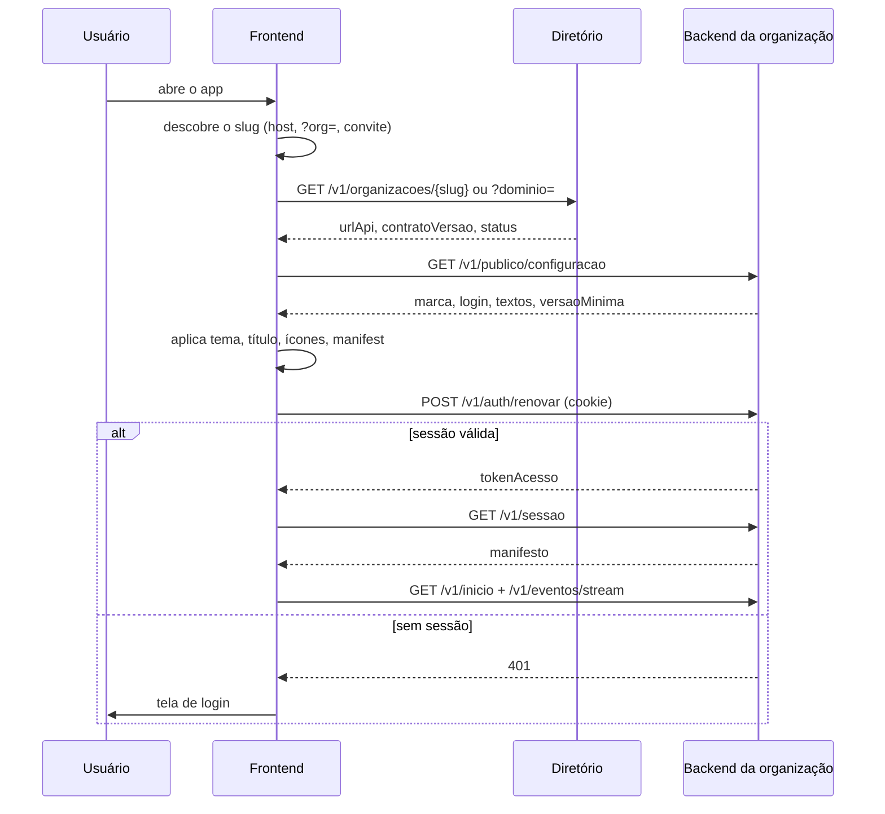

# Prompt do Frontend — PWA único que se adapta a cada organização

{{PRODUTO}} · MVP de acompanhamento entre consultas · versão 1.0 · 05/11/2026

## 0. Como usar este prompt

Esta seção é para você, humano. Da seção 1 em diante, o texto fala com o agente.

- **Onde salvar:** `docs/PROMPT_FRONTEND.md`. Ele depende de `docs/PROMPT_BACKEND.md`, do contrato (`contrato/openapi.yaml`) e do mock (`mock/`), entregues na F0.
- **Ordem:** fases FE0 → FE3 (seção 17). Todas rodam contra o **mock**. Quando o backend real passar na suíte de conformidade, o frontend troca de backend mudando só o endereço do diretório (`VITE_DIRETORIO_URL`).
- **Placeholders:** `{{PRODUTO}}`, `{{DOMINIO}}`.
- **[DECISÃO]** marca escolhas que precisam de confirmação humana. A lista está na seção 19.

## 1. Seu papel e o objetivo

Você é o engenheiro responsável pelo **frontend único** do {{PRODUTO}}: um PWA instalável e responsivo, usado pela equipe (gestor, profissional, secretária) e pelos pacientes (ou responsáveis e tutores).

O frontend **não sabe nada da organização de antemão**. Ao abrir, ele descobre a organização no diretório, lê a configuração pública (marca, login, textos) e, depois do login, o manifesto da sessão (módulos, menu, vocabulário, permissões). A partir disso, desenha o que conhece de um **catálogo fixo de telas e componentes** e ignora o resto.

O teste de que você acertou: **os três cenários do mock** (`modelo-otorrino`, `fisio-movimento`, `vet-amigo`) parecem três produtos diferentes — cor, nome, ícone, vocabulário, menu, tempo real — com **zero `if` por cliente** no código.

### 1.1 Princípios

1. **O backend decide, o frontend desenha.** Mostrar ou esconder um botão depende só de `acoesPermitidas` (do item) e de `permissoes` (do manifesto). Nunca replique regra de negócio: vínculo, horário, status, perfil.
2. **Compatível para frente.** Campo, valor de enum, tela, seção, ícone ou evento desconhecido é ignorado sem erro e sem quebrar a tela. **Não valide respostas da API estritamente em runtime.**
3. **Contrato é a única fonte.** Tipos e chamadas vêm de `@clinica/contrato-cliente` e `@clinica/contrato-tipos`. Não declare à mão tipos que o contrato já tem.
4. **Paciente primeiro.** O usuário mais frágil é um paciente de 70 anos, no pós-operatório, com um iPhone antigo e rede ruim. Desenhe para ele; a equipe usa o mesmo app, com mais densidade.
5. **Privacidade por padrão.** Nada de dado clínico ou nome de paciente em URL, título de aba, log, ferramenta de erro ou armazenamento persistente sem necessidade.

## 2. Stack

| Peça | Escolha | Observação |
|---|---|---|
| Framework | **Vue 3.5**, Composition API, `<script setup>`, TypeScript estrito | |
| Build | Vite | um único build estático servido em todos os domínios |
| Rotas | Vue Router 4 | rotas geradas a partir do catálogo de telas (seção 6) |
| Estado global | Pinia | só sessão, manifesto, tema e conexão; dados de tela ficam no cache de consultas |
| Dados do servidor | **TanStack Query (Vue)** | cache, revalidação, invalidação por evento de tempo real, retry |
| Chamadas | `@clinica/contrato-cliente` (openapi-fetch tipado) | middleware de token, `X-Request-Id`, idempotência |
| Textos da interface | **vue-i18n** | mensagens fixas da UI; vocabulário do domínio vem do backend (seção 8) |
| Componentes base | Reka UI (headless, acessível) + Tailwind CSS v4 com tokens | design system próprio em `src/ds/` |
| Ícones | `lucide-vue-next` | o catálogo de ícones do contrato usa nomes do Lucide |
| PWA | `vite-plugin-pwa` (Workbox, `injectManifest`) | service worker próprio para push e atualização |
| Testes | Vitest + Vue Test Utils; Playwright (E2E contra o mock) | seção 16 |

Nada de SSR, micro-frontends ou bibliotecas de componentes completas (Vuetify, Quasar): o tema dinâmico por organização e o controle de acessibilidade ficam mais simples com headless + tokens. Registre em ADR (`docs/adr/0010-stack-frontend.md`).

## 3. Inicialização: as três camadas



### 3.1 Descoberta da organização

Em ordem de prioridade:
1. Link de convite: `/convite/{token}?org={slug}`.
2. Parâmetro `?org={slug}` — **somente em desenvolvimento** (`import.meta.env.DEV`).
3. Host `{slug}.{{DOMINIO}}` → slug; outro host → `GET /v1/organizacoes?dominio={host}`.

Guarde `{ slug, urlApi }` em `localStorage` (não é dado pessoal) para abrir mais rápido, mas sempre revalide no diretório em segundo plano. Organização desconhecida → tela "Endereço não encontrado".

### 3.2 Status e versão

- `status: MANUTENCAO` → tela de manutenção com `mensagemStatus`, tentando de novo a cada 60 s.
- `status: SUSPENSA` ou erro `ORGANIZACAO_SUSPENSA` → tela informativa, sem login.
- `frontend.versaoMinima` maior que a versão do build → força a atualização do service worker e recarrega (o PWA pode estar em cache há semanas).
- `contratoVersao` com versão maior diferente da suportada → tela "Atualize o app"; versão menor maior é normal (contrato só cresce).

### 3.3 Marca e PWA por organização

- `tema.corMarca` gera uma escala de 50 a 950 (OKLCH). Antes de usar a cor em texto ou botão, **verifique o contraste** (WCAG AA 4,5:1 para texto). Se não passar, escureça ou clareie até passar; nunca desligue o contraste. As cores semânticas (sucesso, atenção, erro, informação) são fixas e não mudam com a marca.
- `modoPadrao` mais a preferência do usuário (`preferencias.tema`) decidem claro ou escuro.
- `document.title`, `<meta name="theme-color">`, `apple-touch-icon` e favicon são aplicados a partir de `pwa` **antes** de o usuário conseguir instalar. O iOS lê esses valores do DOM no momento de "Adicionar à Tela de Início".
- **Manifest web:** o mesmo build serve várias organizações, então `/manifest.webmanifest` não pode ser um arquivo estático. Ele é servido por uma função na borda (CDN) que lê a configuração pública do host; em desenvolvimento, por um middleware do Vite que lê o mock. Detalhe em ADR `0011-manifest-por-organizacao.md`. Não use manifest gerado por `blob:` (instável fora do Chrome).

## 4. Autenticação e sessão

### 4.1 Tokens

- `tokenAcesso` **só em memória** (store Pinia não persistido). Nunca em `localStorage`, `sessionStorage`, IndexedDB ou cookie legível.
- `tokenRenovacao` é cookie `HttpOnly` gerenciado pelo navegador. Toda chamada a `/v1/auth/*` usa `credentials: 'include'`.
- Ao abrir o app: `POST /v1/auth/renovar`. Sucesso → sessão restaurada sem tela de login. 401 → login.
- Renove alguns segundos antes de `expiraEm` e também ao receber `401 SESSAO_EXPIRADA`. A renovação é **única por vez (single-flight)**: várias chamadas que falham juntas esperam a mesma renovação e repetem **uma** vez.
- `401 SESSAO_REVOGADA`, falha na renovação ou evento `sessao.encerrada` → limpa tudo (cache de consultas, stores, dados locais) e vai ao login com aviso.
- **Várias abas:** a rotação do token de renovação com detecção de reuso faz duas abas renovando ao mesmo tempo derrubarem a sessão. Coordene com `navigator.locks.request('renovacao-{slug}', …)` e distribua o token novo às outras abas por `BroadcastChannel`. Esse é o erro mais provável de aparecer em produção: teste com duas abas abertas.

### 4.2 Telas de login (seção 5.2 do backend)

Uma tela por `etapa`, sempre guardando o `desafioId` em memória:

| etapa | Tela |
|---|---|
| — | escolha "Sou paciente" / "Sou da equipe" conforme `autenticacao.metodos[].publico` (se só houver um público, pula) |
| `CODIGO_ENVIADO` / código por e-mail | 6 caixas, `autocomplete="one-time-code"`, `inputmode="numeric"`, colar o código inteiro, reenviar com contagem regressiva |
| `MFA` | código TOTP de 6 dígitos ou "usar código de recuperação" |
| `CONFIGURAR_MFA` | QR de `uriOtpauth` (gerado no cliente), segredo copiável, confirmação e depois os **códigos de recuperação** com "copiei/baixei" obrigatório antes de seguir |
| `TROCAR_SENHA` | nova senha com indicador de força e regra exibida antes do erro |
| `ACEITAR_TERMOS` | link para `termos.url`, aceite explícito |
| `CONCLUIDO` | busca o manifesto e entra |

Etapa desconhecida → mensagem "Atualize o app" (o backend não pode mandar etapa fora do catálogo).

### 4.3 Convite

`/convite/{token}`: `GET /v1/publico/convites/{token}` mostra o nome parcial e o e-mail mascarado; o paciente confirma o e-mail e aceita os termos (`termosVersao` da configuração pública). Após `CONCLUIDO`, abre o **onboarding** (seção 11.3). Convite inválido ou expirado tem tela própria, com o contato da clínica.

### 4.4 Perfis

`perfisDisponiveis` com mais de um item mostra o seletor no menu do usuário. Trocar = `PUT /v1/sessao/perfil-ativo` → novo token → manifesto novo → volta ao início e limpa o cache de consultas (dados visíveis mudam com o perfil).

## 5. Manifesto: como a interface se monta

- Guarde o último manifesto (por organização e usuário) para abrir rápido e revalide com `If-None-Match`. Como ele tem nome e e-mail, guarde em IndexedDB e **apague no logout** [DECISÃO 1].
- `sessao.manifesto.alterado` → busca de novo e reaplica menu, permissões e termos sem recarregar a página.
- `navegacao`:
  - `PRINCIPAL` → barra inferior no celular (até 5) e lateral no desktop;
  - `SECUNDARIO` → menu "Mais" no celular e seção inferior da lateral;
  - item com `destino.tela` fora do catálogo é **ignorado**; ícone desconhecido vira `circle-help`;
  - `contador` mostra o badge com o valor de `contadores[chave]`, que se atualiza pelo evento `contadores.alterados` e por `GET /v1/contadores` ao voltar ao app (`visibilitychange`).
- `modulos[].config` alimenta as telas (ex.: `chat.avisoUrgencia`, `anexosPermitidos`, `horarioAtendimento`).
- Rota acessada diretamente para uma tela de módulo inativo, ou sem item no menu, → "Página indisponível" (não 404 técnico).

## 6. Catálogo de telas

O catálogo é um registro fixo `tela → { rota, componente (lazy), parâmetros, quem usa }`. **Rotas usam só ids opacos**, nunca nome ou dado clínico.

| Tela | Rota | Conteúdo |
|---|---|---|
| `inicio` | `/` | seções de `GET /v1/inicio` na ordem recebida (seção 7) |
| `notificacoes` | `/notificacoes` | central, "marcar todas como lidas", toque leva ao `destino` |
| `perfil` | `/perfil` | nome de exibição, foto, tema, densidade, preferências de notificação, aparelhos com push, sair, sair de todos, excluir conta (paciente) |
| `pacientes.lista` | `/pacientes` | lista paginada, filtro de status, busca (texto no **corpo** de `POST /busca`, com debounce) |
| `pacientes.detalhe` | `/pacientes/:pacienteId` | dados, `acessoApp` (convite pendente, sem push → "avisado por e-mail"), acompanhamentos, ações |
| `pacientes.novo` | `/pacientes/novo` | pessoa ou animal conforme `relacoesPermitidas`; campos adicionais pelo formulário de cadastro; responsáveis/tutor |
| `acompanhamento.lista` | `/acompanhamentos` | filtros (status, com alerta aberto, meus), alertas em destaque |
| `acompanhamento.meus` | `/meus` | paciente: acompanhamentos dos pacientes vinculados, com seletor quando houver mais de um |
| `acompanhamento.detalhe` | `/acompanhamentos/:acompanhamentoId` | linha do tempo de dias (respondido, pendente, expirado, agendado), alertas, equipe, ir para a conversa, encerrar |
| `acompanhamento.novo` | `/acompanhamentos/novo?pacienteId=` | paciente, protocolo, data do procedimento, equipe; prévia dos dias |
| `acompanhamento.protocolos` | `/protocolos` | lista; arquivar |
| `acompanhamento.protocolo` | `/protocolos/:protocoloId` | visualização e edição (nova versão; aviso de que acompanhamentos em andamento não mudam) |
| `acompanhamento.checkin` | `/checkins/:checkinId` | paciente: formulário passo a passo; equipe: respostas, fotos e alertas |
| `chat.lista` | `/conversas` | conversas, não lidas, busca |
| `chat.conversa` | `/conversas/:conversaId` | mensagens, envio otimista, fotos, aviso de urgência fixo (paciente), fora do horário |
| `equipe.lista` | `/equipe` | membros, convite, perfis, suspender, desligar (erro `ULTIMO_GESTOR` com mensagem clara) |
| `organizacao.configuracao` | `/configuracoes` | nome, contato, cor (com prévia e alerta de contraste), logo, textos, horário e mensagens do chat |

Fora do catálogo: `/entrar`, `/convite/:token`, `/manutencao`, `/indisponivel`, `/instalar`.

## 7. Tela inicial

Um componente por `tipo` de seção; tipo desconhecido é ignorado. `titulo` da seção, quando vier, substitui o título padrão (ex.: nome do pet quando a tutora tem dois).

| Tipo | Componente |
|---|---|
| `ACOMPANHAMENTO_ATUAL` | cartão com "Dia 3 de 7", barra de progresso, próximo check-in com chamada grande, orientação do dia. Antes do procedimento (dia negativo): "Faltam 2 dias para a {procedimento}" |
| `CHECKINS_PENDENTES` | lista com botão "Responder" |
| `ALERTAS_ABERTOS` | alertas por severidade (ALTA no topo), com paciente e "Resolver" se permitido |
| `CHECKINS_DO_DIA` | contagem respondidos/pendentes/expirados + lista |
| `ACOMPANHAMENTOS_ATIVOS` | lista resumida com "ver todos" |
| `CONVERSAS_RECENTES` | últimas conversas com não lidas |
| `ATALHOS` | botões com ícone e destino |
| `AVISO` | faixa com `severidade` (`INFORMACAO`, `ATENCAO`, `URGENTE`) |
| `CONTATO_ORGANIZACAO` | ligar (`tel:`), mapa, endereço |

Pull-to-refresh no celular; revalidação automática ao voltar ao app.

## 8. Textos: i18n fixo + vocabulário do backend

Duas fontes, que **não se misturam**:

- **vue-i18n** para tudo que é da interface: botões, mensagens de erro por `codigo`, rótulos fixos, datas, números. Arquivos `src/i18n/pt-BR.json` (e só ele no MVP), com chaves por área (`auth.*`, `chat.*`, `erros.CODIGO`). O idioma vem de `organizacao.locale`; sem tradução, cai para `pt-BR`.
- **`termos` do manifesto** para o vocabulário do domínio (paciente/pet, médico/fisioterapeuta, pós-operatório/recuperação, check-in/registro diário). Vêm em minúsculas, com `genero`.

Combine as duas com helpers puros e testados em `src/i18n/termos.ts`:

```ts
// Ex.: novo(termos.paciente) → "Novo paciente" | novo(termos.acompanhamento) → "Nova recuperação"
export const novo = (t: Termo) => `${t.genero === 'F' ? 'Nova' : 'Novo'} ${t.singular}`;
export const nenhum = (t: Termo) => `${t.genero === 'F' ? 'Nenhuma' : 'Nenhum'} ${t.singular}`;
export const artigo = (t: Termo) => (t.genero === 'F' ? 'a' : 'o');
export const capitalizar = (s: string) => s.charAt(0).toLocaleUpperCase('pt-BR') + s.slice(1);
```

E use-os dentro do i18n com interpolação, não por concatenação espalhada:

```json
{ "lista": { "vazia": "{nenhum} cadastrad{sufixo} ainda." } }
```

```ts
t('lista.vazia', { nenhum: capitalizar(nenhum(termos.paciente)), sufixo: termos.paciente.genero === 'F' ? 'a' : 'o' })
```

Regras:
- `rotulo` de menu, perfil e opções de formulário já vêm prontos: exiba como vieram, sem tradução.
- Plural do domínio usa `termo.plural`; plural de números usa o plural do vue-i18n (`1 mensagem`, `3 mensagens`).
- Nunca monte frase com nome de termo em chave de i18n (`t('novo_paciente')` quebra na clínica veterinária).
- Datas: `Intl.DateTimeFormat(locale, { timeZone: organizacao.fuso })`. **Toda data clínica é exibida no fuso da organização**, não no do aparelho (o paciente pode estar viajando). `Data` (AAAA-MM-DD) nunca passa por `new Date()` sem fuso.

## 9. Dados e tempo real

### 9.1 Consultas

- Uma chave de consulta por recurso (`['acompanhamento', id]`, `['conversas', filtros]`). Listas com cursor usam `useInfiniteQuery`.
- `staleTime` curto (30 s) para listas, revalidação ao focar.
- Erros: `codigo` → mensagem do i18n; sempre mostre o `requestId` em "Detalhes" (para o suporte) e nunca o `detail` cru em destaque.
- `404` em detalhe → "Não encontrado ou sem acesso" (o backend usa 404 para o que o usuário não pode ver). `403` → "Você não pode fazer isso".
- `422` com `campos[]` → erros nos campos correspondentes (`respostas.dor` → campo `dor`).
- `412 CONFLITO_VERSAO` → mostre o `estadoAtual`, explique que outra pessoa alterou e ofereça "recarregar e refazer". Nunca reenvie com `If-Match: *` automaticamente.

### 9.2 Mutações

- Edição envia `If-Match` com o `ETag` da última leitura (guarde o ETag junto com o dado no cache).
- POST marcado como idempotente: gere `Idempotency-Key` **uma vez por ação do usuário** e reutilize em todos os retries dessa ação (rede instável do paciente). Gerar chave nova a cada retry duplica check-ins e mensagens.
- Retry automático só para falhas de rede e 503/429 (respeitando `Retry-After`), nunca para 4xx.

### 9.3 Eventos

- Modo pelo manifesto (`capacidades.tempoReal.modo`). SSE via `fetch` com `Authorization` (use `@microsoft/fetch-event-source` ou implementação própria), reconexão com `Last-Event-ID` e backoff com jitter.
- SSE falhou 3 vezes ou modo `POLLING` → `GET /v1/eventos?depois=` a cada `intervaloPollingSegundos` (pause com a aba oculta; consulte ao voltar).
- `410 CURSOR_EXPIRADO` → invalida todas as consultas e recomeça do `ultimoEventoId`.
- **Uma conexão por organização no navegador**, não por aba: a aba líder (`navigator.locks`) mantém o SSE e repassa os eventos às outras por `BroadcastChannel`.
- O evento só traz ids. Mapeie cada tipo para invalidações:

| Evento | Ação |
|---|---|
| `chat.mensagem.criada` | adiciona/busca a mensagem na conversa aberta; invalida lista de conversas |
| `chat.conversa.atualizada` | invalida a conversa e a lista |
| `acompanhamento.checkin.disponivel` / `respondido` | invalida check-in, acompanhamento e início |
| `acompanhamento.alerta.criado` / `resolvido` | invalida alertas, acompanhamento e início; toast discreto para a equipe |
| `acompanhamento.acompanhamento.atualizado` | invalida o acompanhamento e listas |
| `notificacao.criada` | invalida a central |
| `contadores.alterados` | atualiza os badges direto com os dados do evento |
| `arquivo.processado` | atualiza o upload pendente |
| `sessao.manifesto.alterado` | busca o manifesto de novo |
| `sessao.encerrada` | logout |
| desconhecido | ignora |

## 10. Formulários e check-in

- Um renderizador único (`src/ds/formulario/`) com um componente por `TipoCampo`; tipo desconhecido → aviso "Atualize o app" no lugar do campo e bloqueio do envio se ele for obrigatório.
- `visivelSe` avaliado reativamente com os mesmos operadores do backend; campo oculto tem o valor **removido** das respostas (o backend recusa valor de campo invisível).
- Validação local só para retorno rápido (obrigatório, intervalo, casas decimais); a resposta do servidor é a que vale.
- **Paciente:** um campo por tela no celular, botões grandes, `ESCALA` como botões 0–10 com rótulos das pontas (não slider), progresso "2 de 6", revisão antes de enviar, confirmação calma depois ("Recebido. A equipe vai ver suas respostas."). **Nunca** mostre alerta ou interpretação clínica ao paciente.
- Rascunho do check-in em memória durante a sessão; se o app fechar, recomeça (evita dado clínico persistido no aparelho) [DECISÃO 2].
- `CHECKIN_JA_RESPONDIDO` → mostra o respondido; `CHECKIN_INDISPONIVEL` → explica que expirou e oferece a conversa.
- **Equipe:** respostas em tabela compacta, com destaque nos campos que geraram alerta e fotos ampliáveis.

## 11. Arquivos, push e instalação

### 11.1 Envio de fotos

Fluxo do contrato: `POST /v1/arquivos` → enviar os bytes para `envio.url` com `envio.metodo` e `envio.cabecalhos` (sem `Authorization`: a URL já é assinada) → `/concluir` → aguardar `DISPONIVEL` (evento `arquivo.processado` ou consulta a cada 1 s, até 15 s).
- Reduza a imagem no cliente antes de enviar (lado máximo de 2048 px, JPEG 0,85) para economizar dados móveis; respeite `capacidades.upload`.
- Mostre progresso e permita cancelar; `REJEITADO` mostra `motivoRejeicao`.
- URLs de visualização valem 5 minutos: ao expirar (erro de carregamento da imagem), peça de novo com `GET /v1/arquivos/{id}`. Não guarde URLs assinadas em cache persistente.
- `accept="image/*"` com `capture` opcional; não peça permissão de câmera antes do toque do usuário.

### 11.2 Push

- Peça permissão **somente após um gesto do usuário** e com uma tela explicando o porquê; nunca no carregamento.
- `PushManager.subscribe({ userVisibleOnly: true, applicationServerKey: chavePublicaVapid })` → `POST /v1/notificacoes/push/inscricoes` com o objeto como vem e um nome de aparelho legível.
- Service worker: `push` mostra `titulo`/`texto` do payload (já discretos) com `tag`; `notificationclick` foca uma janela aberta ou abre o app no `destino` (mapeado pelo catálogo de telas).
- **iPhone:** push só funciona com o app adicionado à Tela de Início (iOS 16.4+). Detecte `navigator.standalone` / `display-mode: standalone`; fora disso, mostre o passo a passo de instalação **antes** de oferecer notificações.
- `capacidades.push.modo: NENHUM` → não oferece push.

### 11.3 Onboarding do paciente (logo após o convite)

Pensado para acontecer **na consulta**, com a secretária ao lado: (1) instalar o app (instruções por sistema e navegador), (2) ativar notificações, (3) mostrar onde fica o check-in e a conversa. Cada passo pode ser pulado; o `acessoApp.notificacoes` do paciente (PUSH ou EMAIL) mostra à equipe o resultado.

### 11.4 Atualização e offline

- Precache só do shell (HTML, JS, CSS, fontes, ícones). **Nunca** coloque respostas da API no cache do service worker: elas têm dado pessoal e dependem de token.
- Nova versão disponível → faixa "Atualizar"; versão abaixo de `versaoMinima` → atualização forçada.
- Sem rede: faixa "Sem conexão"; telas mostram o que está no cache em memória; ações de escrita ficam desabilitadas, exceto mensagens do chat (11.5).

### 11.5 Chat

- Envio otimista com `idCliente` (UUID) e `Idempotency-Key` iguais para a mesma mensagem; status "enviando / enviada / falhou — tentar de novo".
- Fila em memória enquanto a página estiver aberta; ao reconectar, reenvia na ordem com a mesma chave.
- Mensagens `CHECKIN` com cartão do resumo e link; `ORIENTACAO` e `SISTEMA` com estilo próprio, sem autor.
- Paciente: `avisoUrgencia` fixo no topo; fora de `horarioAtendimento`, aviso antes de enviar (o backend também responde com mensagem `SISTEMA`).
- Leitura: marque como lida até a última mensagem visível (IntersectionObserver), com debounce.
- Conversa arquivada: campo de envio substituído por "Conversa arquivada" (e "Reabrir" se a ação estiver em `acoesPermitidas`).
- **Nunca use `v-html`** com conteúdo vindo da API; links em texto são detectados e renderizados como texto + `<a rel="noopener noreferrer">`.

## 12. Design system e acessibilidade

- Tokens em CSS custom properties (`--cor-marca-500`, `--cor-erro`, espaçamentos, raios, tipografia), alimentados pelo tema da organização em runtime.
- **WCAG 2.2 AA**: contraste, foco visível, navegação por teclado, `aria-live` para mensagens novas e erros, alvos de toque de no mínimo 44×44 px (48 px no fluxo do paciente), respeito a `prefers-reduced-motion` e ao tamanho de fonte do sistema (até 200% sem quebrar layout).
- Densidade `CONFORTAVEL` (padrão) e `COMPACTA` (equipe), pela preferência do usuário.
- Estados obrigatórios em toda tela: carregando (skeleton), vazio (com termo do domínio), erro (com tentar de novo e `requestId`), sem permissão.
- Layout: mobile-first; a partir de 1024 px, lateral fixa e, nas listas da equipe, mestre-detalhe.

## 13. Segurança e privacidade

- Content Security Policy sem `unsafe-inline` em scripts; `connect-src` limitado a `urlApi` e ao diretório.
- Tokens só em memória (4.1). Nada de dado clínico em `localStorage`. O que for para IndexedDB (manifesto) é apagado no logout e em `sessao.encerrada`.
- URLs e títulos de aba sem nome de paciente ("Conversa — Clínica Modelo", não "Marcos Souza").
- Ferramenta de erros (Sentry, quando houver): `sendDefaultPii: false`, sem corpo de requisição/resposta, *scrubbing* de query strings, apenas `requestId` e rota com ids. Logs de console desligados em produção.
- Botão "Sair de todos os aparelhos" (`todas: true`) no perfil.
- Paciente em aparelho compartilhado: logout limpa cache de consultas, stores, IndexedDB e cache de imagens.

## 14. Estrutura do código

```text
frontend/
  src/
    app/            # bootstrap: descoberta, diretório, configuração, tema, PWA
    api/            # instância do contrato-cliente, renovação single-flight, erros
    sessao/         # store de sessão e manifesto, perfis, permissões
    tempo-real/     # SSE, polling, aba líder, mapa evento → invalidação
    catalogo/       # registro de telas e de seções da tela inicial
    telas/          # uma pasta por tela do catálogo
    ds/             # design system: tokens, componentes base, formulário dinâmico
    i18n/           # pt-BR.json, helpers de termos, formatação de datas no fuso
    pwa/            # service worker, push, instalação
  public/
  tests/
    unit/  componentes/  e2e/
```

Monorepo existente (pnpm workspace): o `frontend/` usa `@clinica/contrato-cliente` e `@clinica/contrato-tipos` via `workspace:*`. Comandos: `pnpm --filter frontend dev`, `build`, `test`, `e2e`.

## 15. Desenvolvimento contra o mock

- `pnpm mock` + `pnpm --filter frontend dev`. `VITE_DIRETORIO_URL=http://localhost:4010/diretorio`; organização por `?org=modelo-otorrino`.
- Logins de teste, código fixo (`123456`), TOTP fixo (`000000`), relógio simulado e simuladores em `mock/README.md`.
- Em desenvolvimento, uma barra de ferramentas (só em `DEV`) com: trocar de organização, avançar relógio (`POST /__mock/relogio`), simular mensagem e check-in, forçar erro (`X-Mock-Erro`) e atraso (`X-Mock-Atraso-Ms`). **As rotas `/__mock` nunca podem ser chamadas no build de produção** (remova por `import.meta.env.DEV`).
- Ao trocar o mock pelo backend real, só muda `VITE_DIRETORIO_URL`. Se precisar mudar código, o problema está no contrato ou na conformidade do backend, não no frontend.

## 16. Testes

| Nível | O quê |
|---|---|
| Unitário (Vitest) | helpers de termos e gênero, datas no fuso, avaliação de `visivelSe`, mapa evento → invalidação, renovação single-flight, geração da escala de cor e ajuste de contraste |
| Componente | renderizador de formulário (todos os tipos, campo desconhecido), seções da tela inicial (incluindo tipo desconhecido), menu com tela/ícone desconhecidos |
| Contrato | respostas dos exemplos em `contrato/exemplos/respostas/` renderizam sem erro; manifesto com campos extras inventados não quebra nada (compatibilidade para frente) |
| E2E (Playwright, contra o mock, `POST /__mock/reiniciar` antes de cada arquivo) | ver abaixo |

Cenários E2E obrigatórios:
1. **Três marcas:** abrir `modelo-otorrino`, `fisio-movimento` e `vet-amigo` e comparar cor, nome, menu e vocabulário (screenshot por organização, claro e escuro).
2. **Paciente:** Marcos entra por código, responde o check-in do dia 3 com sangramento intenso, vê a confirmação, sem ver o alerta.
3. **Equipe em tempo real:** em outro contexto, Ana (MFA `000000`) vê o alerta chegar e o badge mudar **sem recarregar**; resolve o alerta.
4. **Relógio:** avançar 1 dia → o token expira, o app renova sem o usuário perceber, o dia 4 aparece.
5. **Convite:** Paulo aceita o convite e passa pelo onboarding.
6. **Primeiro acesso:** Carlos percorre `TROCAR_SENHA → CONFIGURAR_MFA → ACEITAR_TERMOS`.
7. **Polling:** tutora Laura (vet-amigo) troca entre Thor e Mel e recebe mensagem simulada por polling.
8. **Conflito:** dois contextos editam o mesmo paciente → o segundo vê o 412 tratado.
9. **Rede ruim:** mensagem enviada offline é reenviada ao reconectar, sem duplicar.
10. **Duas abas:** renovação simultânea não derruba a sessão.
11. **Acessibilidade:** `@axe-core/playwright` sem violações sérias nas telas principais dos três cenários.

Orçamento de desempenho (celular intermediário, 4G): JS inicial ≤ 170 KB gzip; LCP ≤ 2,5 s; tela de paciente não carrega código de telas de equipe (split por rota).

## 17. Fases e critérios de saída

| Fase | Entrega | Critério de saída |
|---|---|---|
| **FE0 · Esqueleto** | bootstrap das três camadas, tema e PWA por organização, cliente com renovação, catálogo de telas vazio, design system base, i18n + helpers de termos | as 3 organizações abrem com marca, nome e ícone próprios; manifesto define o menu; testes unitários verdes |
| **FE1 · Login e paciente** | todas as etapas de login, convite, onboarding, início do paciente, check-in, conversa, notificações, perfil, push | E2E 2, 4, 5, 6, 9 verdes; teste manual em iPhone real instalado (push chegando) |
| **FE2 · Equipe** | início da equipe, pacientes, acompanhamentos, protocolos, alertas, chat da equipe, equipe e configuração | E2E 1, 3, 7, 8, 10 verdes; nenhum `if` por organização no código |
| **FE3 · Pronto para o piloto** | acessibilidade, desempenho, segurança (CSP, scrubbing), estados vazios e de erro revisados | E2E 11 verde; orçamentos da seção 16 atendidos; revisão de textos com a clínica piloto; troca para o backend real mudando só `VITE_DIRETORIO_URL` |

Não comece uma fase antes de cumprir o critério de saída da anterior.

## 18. O que nunca fazer

- Mostrar ou esconder algo com base em perfil, slug, nome da organização ou status, em vez de `acoesPermitidas`/`permissoes`.
- Quebrar a tela por campo, enum, tela, seção, ícone ou evento desconhecido.
- Token em `localStorage`, `sessionStorage`, IndexedDB ou cookie legível.
- Nome de paciente ou dado clínico em URL, título de aba, log, ferramenta de erro ou cache do service worker.
- Montar texto de domínio na mão ("Novo paciente" fixo) em vez de usar `termos`.
- Gerar nova `Idempotency-Key` no retry da mesma ação.
- `v-html` com conteúdo da API.
- Chamar `/__mock` fora de desenvolvimento.
- Mostrar alerta, severidade ou interpretação clínica para o paciente.
- Pedir permissão de notificação, câmera ou instalação sem um gesto e uma explicação antes.

## 19. Decisões em aberto

| # | Decisão | Sugestão |
|---|---|---|
| 1 | Guardar o último manifesto no aparelho (abre mais rápido, mas guarda nome e e-mail) | sim, em IndexedDB, apagado no logout |
| 2 | Rascunho do check-in persistido se o app fechar | não no MVP (evita dado clínico no aparelho) |
| 3 | Biblioteca de componentes: headless (Reka UI) + Tailwind ou biblioteca completa | headless + Tailwind (tema por organização e acessibilidade sob controle) |
| 4 | Ferramenta de erros no piloto (Sentry ou similar) e região dos dados dela | Sentry com região na UE ou auto-hospedado, sem PII |
| 5 | Idiomas além de pt-BR | só pt-BR no MVP; estrutura pronta |
| 6 | Modo escuro no MVP | sim (custo baixo com tokens; pacientes usam à noite) |
| 7 | Onde servir o manifest web por organização (função na borda) | função da própria CDN que hospeda o build |

## 20. Formato de resposta

Ao fim de cada tarefa, responda neste formato:

```text
## Resumo
O que foi entregue, em 2 a 4 linhas.

## Telas e regras cobertas
acompanhamento.checkin, RN-ACO-004, renovação single-flight ...

## Arquivos principais
- caminho/arquivo: o que faz

## Decisões
- decisão e motivo (ADR-0010, quando aplicável)

## Testes
- unitários, componentes, E2E e resultado (inclusive nos 3 cenários)

## Pendências e dúvidas
- QUESTION-0xx: ...

## Próximo passo sugerido
```
